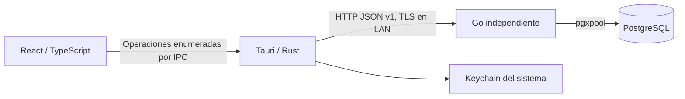

# Arquitectura · Etapa 2

## Responsabilidades

Go es autoridad para configuración persistente, identidad, sesiones, permisos, terminales y auditoría. Rust conserva credenciales duraderas en el almacén seguro del sistema, valida el destino y ejecuta únicamente rutas API enumeradas. React presenta formularios, recoge credenciales transitorias de acceso y refleja las decisiones del servidor. Ningún código de escritorio accede a PostgreSQL.

Tauri no inicia ni detiene Go o PostgreSQL. Los modos `server-terminal`, `terminal-only` y `server-only` conservan los límites de la etapa 1. Todas las funciones usan la misma aplicación de escritorio; su disponibilidad depende de permisos.

## Organización del backend

- `cmd/ad-el-pos-server`: composición, configuración, señales, CLI de migración/aprovisionamiento y ejecución HTTP/TLS.
- `config`: JSON estricto y validación. Parámetros técnicos locales separados de datos del establecimiento.
- `database`: pgxpool acotado, UTC y migraciones SQL embebidas.
- `httpapi`: diagnósticos, CORS exacto, request IDs, límites y logs sin secretos.
- `administration`: servicios con transacción por operación. Archivos por responsabilidad: autenticación, permisos, usuarios, roles, dispositivos, cajas, configuración, preferencias y auditoría.
- `localsetup`: CA y certificado TLS locales; no modifica la confianza global del sistema.
- `licensing`: único límite de integración comercial. Desarrollo permitido, producción bloqueada hasta integrar el proveedor.
- `events`: sobre reservado; `/events` continúa respondiendo 501. La notificación de revocación usa consulta de sesión cada cinco segundos.

Las escrituras y sus eventos de auditoría se confirman en la misma transacción. Los fallos de autenticación y denegaciones relevantes se auditan deliberadamente aunque no se autorice la operación. Los errores públicos no incluyen SQL, hashes, DSN, secretos o detalles del driver.

## Identidad y autorización

Las contraseñas se almacenan con Argon2id: 64 MiB, tres iteraciones, paralelismo uno y sal aleatoria de 16 bytes. La contraseña inicial admin/admin solo se crea durante la inicialización local. Una advertencia no bloqueante permanece hasta cambiarla. Reinicios y migraciones no vuelven a sembrar ni restablecer ese usuario.

`sa` es una identidad reservada, no un rol asignable del personal. Existe sin contraseña utilizable hasta el aprovisionamiento privado local del propietario. Los listados ordinarios excluyen su usuario y rol; los servicios de administración rechazan modificarlo incluso conociendo su UUID. Su acceso normal necesita dispositivo autorizado y una sesión válida. Su actividad aparece en auditoría, incluidos accesos privilegiados de consulta.

Hay siete roles ordinarios iniciales y roles personalizados. El registro central `administration.Permissions` contiene operaciones reales. Un permiso individual explícito allow/deny prevalece sobre el rol; inherit significa ausencia de excepción. Los permisos se resuelven desde PostgreSQL en cada petición, sin conservar autorizaciones en caché. React usa los permisos devueltos para navegación, y Go vuelve a verificarlos.

Los tokens de dispositivo y sesión tienen 256 bits aleatorios; PostgreSQL guarda SHA-256, no los tokens. Cada sesión está ligada al dispositivo y al usuario. Un índice único parcial y un lock de usuario garantizan una sola sesión no revocada por usuario. Un acceso nuevo revoca la anterior; Go rechaza de inmediato sus operaciones y la interfaz informa el reemplazo en la siguiente consulta, como máximo tras el intervalo de cinco segundos si existe conectividad.

Las sesiones expiran a las doce horas. Logout, desactivación, cambio de contraseña, revocación administrativa y revocación de terminal se validan en el servidor. Cinco fallos de acceso por usuario y terminal bloquean nuevos intentos durante quince minutos; las respuestas no distinguen cuentas inexistentes de contraseñas incorrectas.

## Aprovisionamiento y confianza

El asistente requiere una autorización aleatoria generada en un archivo local 0600 y una conexión loopback. Una transacción serializada comprueba si ya existe el establecimiento; repetir el asistente no duplica ni restablece datos. La primera terminal recibe una credencial que Rust guarda directamente en Keychain.

Las terminales adicionales consumen códigos aleatorios de un solo uso, válidos diez minutos, emitidos por un usuario con `devices.manage`. Existe una recuperación local explícita por CLI para el propietario; queda auditada y tampoco autentica automáticamente un usuario. Nombre/UUID de terminal no sustituyen su secreto.

HTTP solo está permitido en loopback. Escucha LAN: IP privada específica, allow_lan explícito, certificado TLS y perfil de desarrollo. El cliente exige HTTPS en LAN y verifica CA y hostname. Los certificados de desarrollo no se instalan globalmente; la CA pública se distribuye por un canal local verificado. Nunca se comparte su clave privada ni la clave del servidor. No hay descubrimiento ni exposición pública a Internet.

Rust usa reqwest sin redirecciones ni proxy automático. La URL de conexión solo procede del archivo local, no de React. El puente admite una lista cerrada de operaciones, valida identificadores y restringe parámetros de consulta. La capability solo pertenece a la ventana local principal; CSP y acceso al sistema siguen restringidos.

La contraseña introducida y el código de enrolamiento existen transitoriamente en el formulario para enviarlos al servidor. No se guardan en React persistente, localStorage o logs. Los tokens duraderos no cruzan al WebView. El código de invitación se muestra temporalmente al administrador para transferir la autorización; no equivale a una sesión ni a una credencial permanente.

## Datos y convenciones

La migración 0001 se conserva. La 0002 crea establecimiento, roles, permisos, usuarios, excepciones, cajas, terminales, invitaciones, sesiones, intentos de acceso, preferencias y auditoría. IDs UUID estables y claves foráneas explícitas. Los datos históricos no se eliminan al desactivar usuarios. No hay turnos, fondos, pagos ni movimientos económicos.

La configuración del establecimiento persiste nombre, zona IANA, MXN, contacto y apariencia inicial. El asistente toma la zona del sistema operativo y permite cambiarla. Los instantes se almacenan como timestamptz y se transportan en UTC; la zona del establecimiento es una configuración de negocio independiente. El tema y pantalla inicial se guardan por usuario; el teclado por terminal. Las pantallas retiradas o no autorizadas vuelven a Estado del sistema.

Las futuras cantidades monetarias deben usar numeric/decimal y cadenas decimales en JSON; nunca float o aritmética financiera con number de JavaScript. Mantener transacciones por invariante y auditoría del actor/dispositivo/operación.

El migrador conserva números, nombres y SHA-256; advisory lock y lote transaccional. Rechaza historial modificado, discontinuo, pendiente o más nuevo. No hay migración automática al abrir Tauri ni down automático. Respaldo y ensayo de restauración anteceden cambios sobre datos importantes; no incluir SQL no transaccional sin revisar el diseño.

## Operación y extensiones

La plantilla launchd sigue sin instalarse. LaunchAgent vive durante la sesión; un servicio comercial sin login requiere diseñar LaunchDaemon con usuario/permisos propios. Go tolera indisponibilidad PostgreSQL y gestiona SIGTERM. Windows Service, instaladores y pruebas Windows siguen pendientes.

Persisten los puntos de extensión para Android offline y KDS: operación UUID, idempotencia transaccional, outbox, cursor de eventos y permisos por estación. No están implementados. Tampoco el proveedor comercial de licencias, sus firmas/caché ni límites comerciales de concurrencia.

`config/product.json` sigue siendo canónico; `sync-metadata.mjs` genera metadatos respetando Prettier. Ver [CODING_CONVENTIONS.md](docs/CODING_CONVENTIONS.md). Antes de distribuir: resolver bundle ID definitivo, firma/notarización, usuario DB runtime separado del migrador, backups/restauración y actualizaciones seguras.
