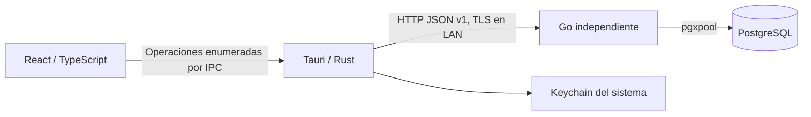

# Arquitectura · Etapa 6

## Responsabilidades

Go es autoridad para configuración persistente, identidad, sesiones, permisos, terminales y auditoría. Rust conserva credenciales duraderas en el almacén seguro del sistema, valida el destino y ejecuta únicamente rutas API enumeradas. React presenta formularios, recoge credenciales transitorias de acceso y refleja las decisiones del servidor. Ningún código de escritorio accede a PostgreSQL.

Tauri no inicia ni detiene Go o PostgreSQL. Los modos `server-terminal`, `terminal-only` y `server-only` conservan los límites de la etapa 1. Todas las funciones usan la misma aplicación de escritorio; su disponibilidad depende de permisos.

## Organización del backend

- `cmd/ad-el-pos-server`: composición, configuración, señales, CLI de migración/aprovisionamiento y ejecución HTTP/TLS.
- `config`: JSON estricto y validación. Parámetros técnicos locales separados de datos del establecimiento.
- `database`: pgxpool acotado, UTC y migraciones SQL embebidas.
- `httpapi`: diagnósticos, CORS exacto, request IDs, límites y logs sin secretos.
- `administration`: servicios con transacción por operación. Archivos por responsabilidad: autenticación, permisos, usuarios, roles, dispositivos, cajas, configuración, preferencias y auditoría.
- `catalog`: documentos y relaciones del catálogo, revisión optimista, disponibilidad, imágenes y cálculo decimal puro. Recibe actor/auditoría desde administración; no importa administración ni depende del escritorio.
- `operations`: áreas, mesas, cuentas, borradores, lotes confirmados, versiones, unidades comerciales y diario de cambios. Comparte transacción, permisos y auditoría con administración y reutiliza el motor de catálogo.
- `localsetup`: CA y certificado TLS locales; no modifica la confianza global del sistema.
- `licensing`: único límite de integración comercial. Desarrollo permitido, producción bloqueada hasta integrar el proveedor.
- `kitchen`: rutas de preparación, liberaciones canónicas, tareas por estación, documentos históricos y cola de impresión. Dos trabajadores y un planificador Go independientes de Tauri.
- `events`: outbox transaccional, secuencia durable, cursor/replay y ámbitos. Administración sirve SSE autenticado; Rust transmite invalidaciones a React mediante Channel.
- `payments`: autoridad financiera de la etapa 6 (saldos, pagos, descuentos, cargos, propinas, IVA, devoluciones, correcciones, turno mínimo, documentos comerciales y entregas). Recibe transacción, actor, auditoría y un autorizador de supervisor desde administración; usa `kitchen` para la cola de impresión y `events` para invalidaciones. `operations` consulta sus guardas.

Las escrituras y sus eventos de auditoría se confirman en la misma transacción. Los fallos de autenticación y denegaciones relevantes se auditan deliberadamente aunque no se autorice la operación. Cada operación autenticada se ejecuta dentro de un savepoint (`administration.runProtected`): un 403 deshace todo lo que la operación hubiera escrito, aunque la verificación de permiso ocurriera después de una escritura, y solo se confirma la auditoría `access.denied`. Así la regla "toda autorización antes de la primera escritura" no depende de convención. Los errores públicos no incluyen SQL, hashes, DSN, secretos o detalles del driver.

## Identidad y autorización

Las contraseñas se almacenan con Argon2id: 64 MiB, tres iteraciones, paralelismo uno y sal aleatoria de 16 bytes. La contraseña inicial admin/admin solo se crea durante la inicialización local. Una advertencia no bloqueante permanece hasta cambiarla. Reinicios y migraciones no vuelven a sembrar ni restablecer ese usuario.

`sa` es una identidad reservada, no un rol asignable del personal. Existe sin contraseña utilizable hasta el aprovisionamiento privado local del propietario. Los listados ordinarios excluyen su usuario y rol; los servicios de administración rechazan modificarlo incluso conociendo su UUID. Su acceso normal necesita dispositivo autorizado y una sesión válida. Su actividad aparece en auditoría, incluidos accesos privilegiados de consulta.

Hay siete roles ordinarios iniciales y roles personalizados. El registro central `administration.Permissions` contiene operaciones reales. Un permiso individual explícito allow/deny prevalece sobre el rol; inherit significa ausencia de excepción. Los permisos se resuelven desde PostgreSQL en cada petición, sin conservar autorizaciones en caché. React usa los permisos devueltos para navegación, y Go vuelve a verificarlos.

La delegación administrativa es segura (`administration/delegation.go`): nadie puede crear, asignar ni editar un rol, ni conceder excepciones, cuyo resultado tenga permisos efectivos que el actor no posee; nadie administra a un usuario con más permisos que los suyos; nadie modifica su propio rol ni sus propias excepciones. Retirar un `deny` también se evalúa como concesión. El resultado se proyecta y autoriza antes de escribir. Debe permanecer al menos un **administrador completo**: un usuario ordinario activo con todos los permisos registrados, determinado por permisos efectivos y no por el código del rol (`sa` no cuenta). Los cambios de usuarios, roles y excepciones que lo eliminarían se rechazan con 400 y se revierten; todos se serializan con el lock 7820148303.

Los tokens de dispositivo y sesión tienen 256 bits aleatorios; PostgreSQL guarda SHA-256, no los tokens. Cada sesión está ligada al dispositivo y al usuario. Un índice único parcial y un lock de usuario garantizan una sola sesión no revocada por usuario. Un acceso nuevo revoca la anterior; Go rechaza de inmediato sus operaciones y la interfaz informa el reemplazo en la siguiente consulta, como máximo tras el intervalo de cinco segundos si existe conectividad.

Las sesiones expiran a las doce horas. Logout, desactivación, cambio de contraseña, revocación administrativa y revocación de terminal se validan en el servidor. Cinco fallos de acceso por usuario y terminal bloquean nuevos intentos durante quince minutos; las respuestas no distinguen cuentas inexistentes de contraseñas incorrectas.

## Aprovisionamiento y confianza

El asistente requiere una autorización aleatoria generada en un archivo local 0600 y una conexión loopback. Una transacción serializada comprueba si ya existe el establecimiento; repetir el asistente no duplica ni restablece datos. La primera terminal recibe una credencial que Rust guarda directamente en Keychain.

Las terminales adicionales consumen códigos aleatorios de un solo uso, válidos diez minutos, emitidos por un usuario con `devices.manage`. Existe una recuperación local explícita por CLI para el propietario; queda auditada y tampoco autentica automáticamente un usuario. Nombre/UUID de terminal no sustituyen su secreto.

HTTP solo está permitido en loopback. Escucha LAN: IP privada específica, allow_lan explícito, certificado TLS y perfil de desarrollo. El cliente exige HTTPS en LAN y verifica CA y hostname. Los certificados de desarrollo no se instalan globalmente; la CA pública se distribuye por un canal local verificado. Nunca se comparte su clave privada ni la clave del servidor. No hay descubrimiento ni exposición pública a Internet.

Rust usa reqwest sin redirecciones ni proxy automático. La URL de conexión solo procede del archivo local, no de React. El puente admite una lista cerrada de operaciones, valida identificadores y restringe parámetros de consulta. La capability solo pertenece a la ventana local principal; CSP y acceso al sistema siguen restringidos.

La contraseña introducida y el código de enrolamiento existen transitoriamente en el formulario para enviarlos al servidor. No se guardan en React persistente, localStorage o logs. Los tokens duraderos no cruzan al WebView. El código de invitación se muestra temporalmente al administrador para transferir la autorización; no equivale a una sesión ni a una credencial permanente.

## Datos y convenciones

La migración 0001 se conserva. La 0002 crea establecimiento, roles, permisos, usuarios, excepciones, cajas, terminales, invitaciones, sesiones, intentos de acceso, preferencias y auditoría. IDs UUID estables y claves foráneas explícitas. Los datos históricos no se eliminan al desactivar usuarios. Turnos, pagos y movimientos económicos llegan con la 0006 (etapa 6).

La configuración del establecimiento persiste nombre, zona IANA, MXN, contacto y apariencia inicial. El asistente toma la zona del sistema operativo y permite cambiarla. Los instantes se almacenan como timestamptz y se transportan en UTC; la zona del establecimiento es una configuración de negocio independiente. El tema y pantalla inicial se guardan por usuario; el teclado por terminal. Las pantallas retiradas o no autorizadas vuelven a Estado del sistema.

Las cantidades monetarias usan numeric/decimal y cadenas decimales en JSON; nunca float o aritmética financiera con number de JavaScript. Mantener transacciones por invariante y auditoría del actor/dispositivo/operación.

El migrador conserva números, nombres y SHA-256; advisory lock y lote transaccional. Rechaza historial modificado, discontinuo, pendiente o más nuevo. No hay migración automática al abrir Tauri ni down automático. Respaldo y ensayo de restauración anteceden cambios sobre datos importantes; no incluir SQL no transaccional sin revisar el diseño.

## Operación y extensiones

La plantilla launchd sigue sin instalarse. LaunchAgent vive durante la sesión; un servicio comercial sin login requiere diseñar LaunchDaemon con usuario/permisos propios. Go tolera indisponibilidad PostgreSQL y gestiona SIGTERM. Windows Service, instaladores y pruebas Windows siguen pendientes.

La etapa 4 implementa UUID e idempotencia transaccional de operaciones del restaurante y un diario durable. La etapa 5 añade publicación/replay autenticado y ámbito por estación. Android y offline durable siguen pendientes. Siguen pendientes el proveedor comercial de licencias, sus firmas/caché y límites comerciales de concurrencia.

`config/product.json` sigue siendo canónico; `sync-metadata.mjs` genera metadatos respetando Prettier. Ver [CODING_CONVENTIONS.md](docs/CODING_CONVENTIONS.md). Antes de distribuir: resolver bundle ID definitivo, firma/notarización, usuario DB runtime separado del migrador, backups/restauración y actualizaciones seguras.

## Catálogo y cálculo comercial

La 0003 añade productos con UUID estables, categorías, variantes opcionales, ingredientes/receta, complementos, porciones, grupos/opciones/originales incluidos, componentes y alternativas de combo, tramos, listas y promociones. Valores `numeric`, claves foráneas y desactivación lógica. Solo se siembra la lista predeterminada Restaurante; no hay productos ficticios. Los permisos nuevos se agregan al registro y al administrador sin restablecer usuarios ni modificar el mecanismo reservado sa.

`administration` autentica cada petición y delega `catalog/*` pasando la misma transacción, permisos efectivos y callback de auditoría. El catálogo usa un advisory lock compartido para lecturas/cálculos y exclusivo para escrituras; así, un snapshot no mezcla revisiones ni permite validar simultáneamente ciclos incompatibles. Cada documento posee revisión; cambios de estado, disponibilidad y orden también la incrementan.

`catalog.Calculate` es una función determinista del snapshot, solicitud, instante del servidor y zona del establecimiento. Un estado de cálculo acota la expansión recursiva. Se utiliza `shopspring/decimal` y se devuelven cadenas; React no calcula importes. El resultado incluye bases/origen, ingredientes, valores incluido/solicitado, diferencia/extras, árbol de componentes y promociones con motivos. Ver [CATALOG.md](docs/CATALOG.md) para reglas de redondeo, equivalencia, tramos y acumulación.

Los logos originales se empaquetan con Vite y `BrandLogo` usa CSS por tema sin servicios externos. Las fotografías del catálogo se validan completamente en Go y guardan en PostgreSQL; llegan autenticadas por IPC como URI data. No se habilita acceso general al filesystem ni se amplía CSP. Las rutas de catálogo y restaurante admiten cuerpos de hasta 2 MiB; el resto conserva 64 KiB.

El componente `ProductCustomizer` admite componentes anidados y mantiene selecciones estructuradas y observaciones. `PreviewPage` permite varias líneas solo para comprobar promociones. La persistencia de pedidos pertenece a `operations`; no hay reservas, impuestos, pagos ni consumo de inventario. La captura operativa solicita el cálculo y persiste su snapshot en la transacción comercial.

## Operación persistida del restaurante

La 0004 añade once tablas operativas y veintiún permisos. No inserta áreas, mesas ni cuentas ficticias. Se conserva la instalación, las credenciales y las migraciones 0001–0003. `administration` autentica y delega `restaurant/*` en la misma transacción. Cada escritura valida permisos/revisión, toma lock exclusivo 7820148305, guarda el resultado idempotente y audita antes del commit. Lecturas y previsualizaciones toman lock compartido. El motor de catálogo conserva su lock 7820148304, siempre adquirido después del operativo.

Una confirmación guarda lote, snapshot comercial y cotización. Las versiones de partidas son inmutables; cada unidad conserva UUID, ordinal y centavos. Dividir y transferir actualiza la pertenencia de esas unidades. Modificar conserva la historia y registra una versión nueva. Observaciones o reducciones sin cambio de receta conservan importes; otros cambios requieren cotización expresa vigente. Ver las reglas y límites en [RESTAURANT_OPERATIONS.md](docs/RESTAURANT_OPERATIONS.md).

`restaurant_operations` vincula UUID a actor, terminal, ruta, hash de cuerpo y resultado. `restaurant_events` conserva cambios anterior/posterior, cuentas relacionadas, unidades y secuencia. Sus claves a operación son diferibles para guardar resultado y eventos atómicamente. La etapa 5 integra ese diario con cocina y publica invalidaciones mediante outbox/SSE. Ningún traslado de cuenta constituye otra preparación o movimiento físico.

React usa recursos sondeados con generaciones para descartar respuestas antiguas, un controlador de mutaciones con recuperación del mismo UUID y un espacio de operación que conserva selección no guardada. El borrador persistido sobrevive reinicios; el editor local y el reintento pendiente son memoria del proceso. La pantalla operativa mantiene cuenta y total visibles con desplazamientos internos a 1280×720. No hay cálculos de dinero en TypeScript.

`Accordion` conserva controles montados e inaccesibles al foco cuando está cerrado, revela validaciones y respeta movimiento reducido. `VirtualKeyboard` utiliza la preferencia de terminal y reserva espacio para formularios. La aceptación visual usa Chromium/WebKit con Go y PostgreSQL temporales reales; el IPC de prueba solo existe en el ejecutor y mantiene credenciales en Node. El producto compilado continúa requiriendo Tauri y Keychain.

## Preparación, transportes y eventos · etapa 5

La migración 0005 añade 17 tablas y veinte permisos sin modificar 0001–0004. `operations` llama a `kitchen.Integrate` dentro de su misma transacción. Una confirmación crea intención durable; una liberación crea un marcador único por unidad comercial, tareas por estación y documentos/cola. El marcador canónico servirá para inventario futuro, sin registrar consumo ahora. Cambios históricos usan versiones y destinos congelados; una configuración inválida conserva avisos durables y bloquea avances de la versión anterior.

El planificador toma el lock operativo y procesa vencimientos cada segundo. Los trabajadores de impresión reclaman con SKIP LOCKED, persisten intento/lease antes del transporte y conservan un lock de sesión por impresora durante el envío. Nunca mantienen una transacción SQL abierta mientras se imprime. Una caída o confirmación perdida produce incertidumbre, sin reenvío automático. El respaldo debe ser explícito y solo se usa después de tres fallos confirmados consecutivos sin envío; un intento incierto o en intervención interrumpe esa cuenta. No se puede prometer exactamente una copia física entre una base y un dispositivo sin commit compartido.

Los transportes aislados son CUPS local y ESC/POS TCP a IP privada. No existe ejecución de shell o comandos introducidos por el cliente. El destino agente futuro informa intervención. Los documentos se renderizan en Go y se almacenan con configuración histórica. Reimprimir no afecta la liberación ni añade etiquetas; las vistas autorizadas ocultan precios salvo permiso y configuración expresa.

`realtime_events` comparte commit con cada cambio operativo. Un lock de publicación ordena la asignación de secuencia hasta commit, evitando huecos causados por transacciones concurrentes. SSE es el equivalente elegido a WebSocket para invalidación unidireccional; comandos/acuse siguen HTTP idempotente. Rust conserva credenciales y entrega frames por Channel. Hay replay lógico de 5000 secuencias, lotes 200, reset y consulta completa, filtro por permisos/terminal/estación y dos conexiones por dispositivo. La revocación se revalida durante el flujo. El sondeo recupera conectividad y la selección local no se sustituye por eventos.

La ventana Tauri inicia fullscreen nativo y permite salir/regresar sin quiosco. El diseño utiliza columnas fluidas y conserva formularios al cambiar resolución. Ver [KITCHEN_AND_PRINTING.md](docs/KITCHEN_AND_PRINTING.md) para contratos KDS, estados, límites y configuración; [VERIFICATION.md](docs/VERIFICATION.md) distingue pruebas de navegador, nativas y hardware.

## Cobros y finanzas · etapa 6

La migración 0006 añade el modelo financiero completo sin modificar 0001–0005: políticas de cobro e IVA, métodos de pago, turno mínimo, pagos y asignaciones, devoluciones y sus reversos, ajustes (descuentos manuales, cortesías y cargos) con cancelación compensatoria, autorizaciones de supervisor, límites de descuento por rol, movimientos de turno, entregas para llevar y documentos comerciales. `restaurant_accounts.state` admite `closed`, cada versión confirmada guarda su `tax_rate` y `kitchen_tickets.kind` admite `receipt` y `precheck`. Las filas existentes reciben IVA 16 %.

`administration` autentica y delega `payments/*` en la misma transacción con el actor, la auditoría y un autorizador de supervisor (`administration/supervisor.go`) que reutiliza el límite de intentos del inicio de sesión, rechaza la autoautorización y no crea sesiones. Las escrituras toman el lock operativo 7820148305 exclusivo (el mismo del restaurante y la cocina) y las lecturas o previsualizaciones, compartido; no hay locks nuevos. La idempotencia reutiliza `restaurant_operations`, con una huella que excluye la contraseña de autorización.

`payments` calcula el estado financiero de una cuenta exclusivamente desde registros persistidos: total de unidades activas menos descuentos vigentes más cargos vigentes; pagado como pagos menos devoluciones. El repartidor `allocate` distribuye centavos por residuo mayor con desempate por posición, de modo que la suma siempre es exacta. El IVA está incluido: el desglose agrupa por tasa histórica (base redondeada, IVA como diferencia) y las devoluciones congelan su desglose. `operations` consulta las guardas de `payments` antes de transferir, dividir, combinar, cancelar, editar o anular, y las cuentas exponen un resumen `finance` en lugar de estados declarados.

Los documentos comerciales se generan en Go (`payments/documents.go`) y se encolan mediante `kitchen.EnqueueCommercial` en la impresora de tickets configurada; comparten la cola, el lease y la resolución de incertidumbre de la etapa 5, pero no aparecen entre las comandas ni crean liberaciones. Un fallo de impresión no afecta el pago. Ver [PAYMENTS_AND_REFUNDS.md](docs/PAYMENTS_AND_REFUNDS.md).
