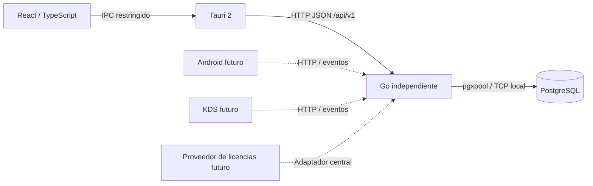

# Arquitectura · Etapa 1

## Componentes y límites

Go es dueño de los datos y reglas. Tauri crea una ventana, lee configuración de conexión y realiza tres GET técnicos fijos mediante reqwest. No inicia Go, PostgreSQL ni comandos del sistema. React separa servicios, interpretación de respuestas, hook de consulta y presentación. No hay acceso SQL desde Rust/React ni credenciales DB en el bundle.

El puente HTTP nativo permite seleccionar un servidor en ejecución sin abrir `connect-src` a toda la red. La capability `main` autoriza solo `connection_config` y `server_snapshot`. No hay plugins de shell, filesystem o SQL. El contenido remoto no tiene capacidades; la ventana contiene assets locales. La CSP de producción mantiene `script-src 'self'`; el permiso de scripts inline de desarrollo sirve a React/Vite. Los estilos inline están permitidos; no se usa `unsafe-eval`.

La vista de navegador es solo una ayuda de desarrollo: usa fetch, CORS exacto y la configuración generada. La interfaz operativa es Tauri. Ninguna fuente, icono o biblioteca requiere CDN en ejecución.

## Tres instalaciones, una aplicación

| Modo | Procesos y configuración |
| --- | --- |
| `server-terminal` | PostgreSQL + Go independiente + escritorio. El escritorio nunca se responsabiliza de arrancar o detener los otros dos. |
| `terminal-only` | El mismo escritorio; selecciona un Go existente por URL. No instala DB ni Go. El backend rechaza este modo. |
| `server-only` | PostgreSQL + Go; no requiere Rust, Node, Tauri ni ventana en ejecución. |

Estos modos están implementados por configuración, no por un instalador/asistente. No hay ediciones separadas para cajero/administrador: las futuras funciones dependerán de permisos validados en Go.

## Backend

- `cmd/ad-el-pos-server`: composition root, CLI, señales y cierre ordenado. Dependencias de arriba hacia `internal`.
- `config`: JSON estricto, validación, secreto opcional desde `ADEL_DB_PASSWORD`. No usa dependencias externas.
- `database`: único adaptador PostgreSQL, pgxpool acotado, timeouts, conexiones con UTC. El proceso HTTP puede iniciar sin DB y reportar `503` hasta su recuperación.
- `httpapi`: net/http estándar; GET técnicos, JSON uniforme, request IDs aleatorios, CORS de orígenes exactos, límites de cabeceras y tiempos. No hay router/framework adicional.
- `licensing`: una verificación de arranque permite desarrollo local y rechaza producción sin proveedor. No hay protocolo de licencias inventado ni comprobaciones repartidas.
- `events`: sobre JSON reservado. `/events` devuelve `501`: no existe WebSocket, bus, replay ni entrega garantizada todavía.

Los futuros módulos se añaden cuando exista su primer caso de uso real: handler → servicio de aplicación → repositorio PostgreSQL. No crear capas o interfaces de repositorio sin una necesidad de sustitución/prueba concreta. Las transacciones se delimitan en el servicio de aplicación y se propagan a las operaciones del repositorio. No llamar handlers desde otros módulos.

Logs JSON a stdout; las respuestas de red no incluyen mensajes del driver, SQL, DSN, secretos ni rutas locales. El HTTP no registra cuerpos, query strings ni headers. Son logs de operación, todavía no auditoría de negocio ni sistema de rotación.

## Esquema y migraciones

SQL embebido en el binario, migraciones `0001_descripcion.sql` consecutivas e inmutables después de aplicarse. El comando `migrate` toma un advisory lock transaccional y aplica todo el lote pendiente dentro de una transacción. Guarda número, nombre, SHA-256 y fecha UTC en `public.schema_migrations`; un fallo revierte el lote, incluido el registro. Dos migradores no aplican dos veces el mismo SQL.

El esquema actual contiene únicamente el registro técnico y el namespace `app`. La disponibilidad comprueba conexión y coincidencia exacta del historial con el binario. Detecta versiones faltantes, nuevas, discontinuas y checksum alterado; no es una auditoría general de modificaciones manuales de todas las tablas. Nunca ejecutar DDL manual sobre esquemas administrados.

No hay migraciones automáticas al iniciar Go/Tauri, ni down automático. Para cambios futuros: respaldo → ensayo de restauración → migración explícita → comprobación de compatibilidad. `backup` produce un pg_dump custom y comprueba su catálogo; el ensayo de restauración sigue siendo un paso independiente. Cambios no transaccionales (p. ej. `CREATE INDEX CONCURRENTLY`) necesitan otro diseño revisado; no introducirlos en este migrador.

Convenciones futuras:

- UUID generados de forma inequívoca para entidades/operaciones; elegir versión final con el primer módulo. No usar nombres o índices visuales como identidad.
- FK explícitas, índices en relaciones y `ON DELETE` deliberado; evitar cascadas implícitas para datos comerciales.
- Transacciones para invariantes multi tabla; versionado optimista para edición concurrente. Un único servidor PostgreSQL es autoridad de cada instalación.
- `timestamptz` para instantes, UTC en transporte/almacenamiento. Zona IANA del restaurante aparte para fechas de negocio y cierres; no derivarla del equipo cliente.
- Dinero `numeric(precision,scale)` y aritmética decimal exacta. JSON decimal como cadena; nunca `float32/float64` ni `number` de JS para cálculos financieros. Precisiones, monedas y reglas de redondeo se fijarán con requisitos.
- Auditoría futura en la misma transacción: actor, dispositivo, operación, instante y cambio. No confundir con logs HTTP.
- Compatibilidad por API y esquema declarada. Etapa 1 exige esquema exacto; políticas de actualizaciones graduales se diseñarán antes de distribuir clientes móviles.

## Red, autenticación y operación

Por defecto solo `127.0.0.1:8181`; DB exclusiva en `127.0.0.1:55432`. LAN requiere IP privada específica, `allow_lan=true` y `environment=development`; se rechazan `0.0.0.0`, direcciones públicas y producción LAN. Solo sirve para pruebas técnicas en red controlada. CORS no sustituye autenticación ni bloquea clientes nativos.

Antes de habilitar datos de negocio: enrolamiento de dispositivo, sesión de usuario, permisos en backend, TLS con confianza administrada, límites por dispositivo, revocación y firewall. No exponer este backend a Internet. SSL PostgreSQL `disable` solo se acepta en IP loopback de desarrollo; en otros casos se exige `verify-full`.

El ejemplo launchd ejecuta Go en primer plano, con rutas absolutas, señales y reintento moderado. Un LaunchAgent vive durante la sesión de usuario; para un servicio comercial independiente del inicio de sesión se deberá diseñar un LaunchDaemon con usuario de servicio y permisos restringidos. No se instaló ninguno. PostgreSQL requiere su propia gestión del servicio; Go tolera que llegue después. No depender del orden de arranque de launchd ni del ciclo de vida de Tauri.

Los scripts actuales son para macOS. El código Go/Rust/React conserva compatibilidad de plataforma; servicio Windows, impresión, descubrimiento LAN, certificados, actualizaciones e instaladores siguen pendientes y no se probaron.

## Identidad y renombrado

`config/product.json` es la fuente canónica de nombre, versión, ID técnico, API y esquema. `scripts/sync-metadata.mjs` actualiza metadatos embebidos Go, React, package/Cargo y Tauri. `--check` detecta divergencia; se ejecuta en pruebas. Cambiar `name` modifica el nombre visible. Para cambiar IDs técnicos también revisar rutas de comando, módulo Go, scripts, nombres de rol/DB y la plantilla launchd: una identidad persistente no debe renombrarse silenciosamente.

El bundle ID `local.adel.pos.dev` es válido y provisional. Sustituirlo por un identificador controlado antes de distribución y decidir la migración del directorio de configuración. El icono es provisional. Actualizar lockfiles después de cambiar la versión de paquetes y ejecutar todas las comprobaciones.
