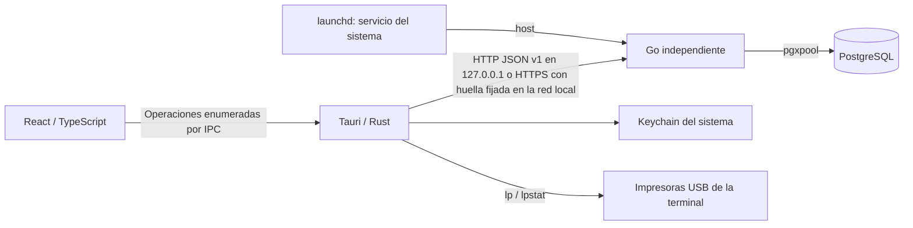
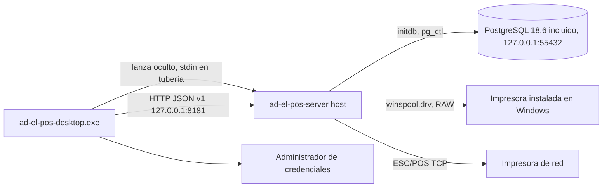

# Arquitectura · Etapa 9G

## Responsabilidades

Go es autoridad para configuración persistente, identidad, sesiones, permisos, terminales y auditoría. Rust conserva credenciales duraderas en el almacén seguro del sistema, valida el destino y ejecuta únicamente rutas API enumeradas. React presenta formularios, recoge credenciales transitorias de acceso y refleja las decisiones del servidor. Ningún código de escritorio accede a PostgreSQL.

En macOS y en desarrollo, Tauri no inicia ni detiene Go o PostgreSQL; desde la etapa 9E, solo la instalación de Windows los lanza y los detiene con la aplicación (ver «Windows · etapa 9E»). Desde la etapa 9G, en macOS el servidor de la computadora principal es un servicio del sistema (`LaunchDaemon`) que arranca con la computadora, sin sesión, y la aplicación solo crea o quita su archivo de habilitación al cambiar la modalidad (ver «Servidor del restaurante, terminales en red y API para Android · etapa 9G»). El almacén seguro es Keychain en macOS y el Administrador de credenciales en Windows. Las modalidades `server-terminal`, `server-only` y `terminal-only` se eligen al instalar o en el primer arranque desde la 9G. Todas las funciones usan la misma aplicación de escritorio; su disponibilidad depende de permisos.

## Organización del backend

- `cmd/ad-el-pos-server`: composición, configuración, señales, CLI de migración/aprovisionamiento y ejecución HTTP/TLS.
- `config`: JSON estricto y validación. Parámetros técnicos locales separados de datos del establecimiento.
- `database`: pgxpool acotado, UTC y migraciones SQL embebidas.
- `httpapi`: diagnósticos, CORS exacto, request IDs, límites y logs sin secretos.
- `administration`: servicios con transacción por operación. Archivos por responsabilidad: autenticación, permisos, usuarios, roles, dispositivos, cajas, configuración, preferencias y auditoría.
- `catalog`: documentos y relaciones del catálogo, revisión optimista, disponibilidad, imágenes y cálculo decimal puro. Recibe actor/auditoría desde administración; no importa administración ni depende del escritorio.
- `operations`: áreas, mesas, cuentas, borradores, lotes confirmados, versiones, unidades comerciales y diario de cambios. Comparte transacción, permisos y auditoría con administración y reutiliza el motor de catálogo. Desde la etapa 9D recibe también el autorizador de supervisor (como `payments`) para «Cancelar cuenta» y administra el catálogo de motivos de cancelación.
- `localsetup`: CA y certificado TLS locales; no modifica la confianza global del sistema. Desde la etapa 9G, la identidad propia del servidor (`identity.go`: `server_id`, certificado ECDSA P-256 autofirmado y su llave, creada de forma atómica y nunca reemplazada sola).
- `licensing`: único límite de integración comercial. Desarrollo permitido, producción bloqueada hasta integrar el proveedor.
- `kitchen`: rutas de preparación, liberaciones canónicas, tareas por estación, documentos históricos y cola de impresión. Dos trabajadores y un planificador Go independientes de Tauri.
- `events`: outbox transaccional, secuencia durable, cursor/replay y ámbitos. Administración sirve SSE autenticado; Rust transmite invalidaciones a React mediante Channel.
- `payments`: autoridad financiera de la etapa 6 (saldos, pagos, descuentos, cargos, propinas, IVA, devoluciones, correcciones, documentos comerciales y entregas) y, desde la etapa 7, de la administración de caja (archivos `cash_*.go`: turnos, operaciones de efectivo, cortes, arqueo, cierre, documentos de caja, cajón y tope). Recibe transacción, actor, auditoría y un autorizador de supervisor desde administración; usa `kitchen` para la cola de impresión y `events` para invalidaciones. `operations` consulta sus guardas.
- `inventory` (etapa 8): insumos, unidades y presentaciones, almacenes, existencias, libro de movimientos y motor de costos, recetas y subrecetas, consumo por liberación a cocina con su trabajador, cancelaciones, elaboraciones, compras (proveedores, órdenes, recepciones, devoluciones y vínculo opcional con gastos de caja), ajustes, mermas, transferencias, conteos, alertas y sugerencias. Recibe transacción, actor y auditoría desde administración; no importa `operations`, `kitchen`, `payments` ni `administration` y lee sus tablas solo por SQL de lectura. `kitchen` lo llama para registrar solicitudes de consumo. Desde la etapa 9A agrega el proveedor especial «Compras de mostrador» y la comprobación del código interno sugerido.
- `businessday` (etapa 9A): paquete neutral, sin dependencias de otros módulos, con el día comercial («Hora de inicio del día», `inventory_settings.operating_day_cutoff`) y los periodos con semana ISO 8601 en la zona del establecimiento. Lo usan inventario (día operativo de las cancelaciones y alertas) y reportes.
- `reports` (etapa 9A): registro cerrado de reportes, motor de orden, página y totales, ejecutor de solo lectura con semáforo propio, resumen ejecutivo, opciones de filtros y exportación PDF/XLSX. Recibe de administración la transacción de autenticación solo para validar ruta, permisos y parámetros; consulta después en su propia transacción. No importa `administration` ni llama handlers de otros módulos: lee sus tablas por SQL y usa funciones puras exportadas de `payments`, `inventory`, `businessday` y `moneytext` (importes de los PDF).
- `documents` (etapa 9B): paquete neutral, sin importar `kitchen`, `payments`, `operations` ni `administration`, con los diez tipos de documento, el modelo de plantilla por bloques de un catálogo cerrado, su validación, los datos tipados de cada familia (cocina, comercial y caja), el renderizador único que produce la representación intermedia (IR), las plantillas predeterminadas, los datos de muestra, la codificación ESC/POS de una IR con atributos y el acceso a versiones e identidad. `kitchen` y `payments` convierten sus estructuras a esos datos.
- `designer` (etapa 9B): rutas `documents/*` (catálogo, plantillas, versiones, vista previa, recientes, muestras e impresoras); usa `documents`, `kitchen` (cola y documentos de cocina) y `payments` (fuentes de vista previa).
- `identity` (etapa 9B): rutas `documents/identity*`, identidad documental combinada con `app.establishment`, logotipo con sus conversiones guardadas, fuente de bits para el trabajador de impresión y fuente del logotipo de los reportes (un `SELECT` en la transacción de solo lectura del reporte).
- `logoraster` y `brand` (etapa 9B): puros; validación y conversión monocromática del logotipo y bytes `GS v 0`, y copia embebida de la marca de AD-EL POS para los reportes.
- `maintenance` (etapa 9F): «Quitar datos de prueba». Firmas exactas de lo que crean las pruebas (lista cerrada, cada una con su archivo de prueba), plan de qué se elimina, desactiva, desvincula o conserva con los registros relacionados leídos de las llaves foráneas de PostgreSQL, aplicación en una transacción y respaldo previo con `pg_dump` (en el `host` de Windows, el de `standalone`). Lo llama `administration` (`maintenance.go`), que autoriza, respalda y aplica.
- `lanlistener` (etapa 9G): escucha HTTPS de la red local con filtro de orígenes (loopback o privados, de enlace local o ULA dentro de la subred de una interfaz local que no sea punto a punto) y la marca `FromNetwork` en el contexto de cada petición.
- `discovery` (etapa 9G): anuncio `_adelpos._tcp` con el respondedor mDNS del sistema (`dns-sd -R` en macOS; Windows en la Fase W), solo con la escucha de red y nunca en modo de pruebas.
- `backupschedule` (etapa 9G): respaldos programados (programación, archivos, retención de lo registrado, ejecuciones, aviso y trabajador) sobre `maintenance.ScheduledBackuper`; lo llama `administration` (`backups.go`).
- `apicontract` e `idempotency` (etapa 9G): contrato OpenAPI 3.1 de la API para clientes con su validador y su prueba de contrato, y la idempotencia sobre `restaurant_operations` para módulos sin una propia (como «Agotado»).
- `standalone` (etapa 9E; desde la 9G también macOS): carpeta de datos, clúster propio, bloqueo, respaldo antes de migrar, respaldos, restauración, modalidad y habilitación, y paso de una instalación anterior (`adopt-legacy`); lo usa el comando `host`.
- `stationscope` (etapa 9F): paquete neutral con la regla única de las estaciones que se ven en Cocina (estaciones de la terminal ∩ estaciones del usuario; con `kitchen.stations.all`, todas las del usuario). Lo usan `kitchen` (tablero, estados, acuses y comandas), `events` (`events.Read` recibe un `*stationscope.Scope`) y `administration` (SSE y estaciones por usuario).

Las escrituras y sus eventos de auditoría se confirman en la misma transacción. Los fallos de autenticación y denegaciones relevantes se auditan deliberadamente aunque no se autorice la operación. Cada operación autenticada se ejecuta dentro de un savepoint (`administration.runProtected`): un 403 deshace todo lo que la operación hubiera escrito, aunque la verificación de permiso ocurriera después de una escritura, y solo se confirma la auditoría `access.denied`. Así la regla "toda autorización antes de la primera escritura" no depende de convención. Los errores públicos no incluyen SQL, hashes, DSN, secretos o detalles del driver.

## Identidad y autorización

Las contraseñas se almacenan con Argon2id: 64 MiB, tres iteraciones, paralelismo uno y sal aleatoria de 16 bytes. La contraseña inicial admin/admin solo se crea durante la inicialización local. Una advertencia no bloqueante permanece hasta cambiarla. Reinicios y migraciones no vuelven a sembrar ni restablecer ese usuario.

`sa` es una identidad reservada, no un rol asignable del personal. Existe sin contraseña utilizable hasta el aprovisionamiento privado local del propietario. Los listados ordinarios excluyen su usuario y rol; los servicios de administración rechazan modificarlo incluso conociendo su UUID. Su acceso normal necesita dispositivo autorizado y una sesión válida. Su actividad aparece en auditoría, incluidos accesos privilegiados de consulta.

Hay siete roles ordinarios iniciales y roles personalizados. El registro central `administration.Permissions` contiene operaciones reales. Un permiso individual explícito allow/deny prevalece sobre el rol; inherit significa ausencia de excepción. Los permisos se resuelven desde PostgreSQL en cada petición, sin conservar autorizaciones en caché. React usa los permisos devueltos para navegación, y Go vuelve a verificarlos.

La delegación administrativa es segura (`administration/delegation.go`): nadie puede crear, asignar ni editar un rol, ni conceder excepciones, cuyo resultado tenga permisos efectivos que el actor no posee; nadie administra a un usuario con más permisos que los suyos; nadie modifica su propio rol ni sus propias excepciones. Retirar un `deny` también se evalúa como concesión. El resultado se proyecta y autoriza antes de escribir. Debe permanecer al menos un **administrador completo**: un usuario ordinario activo con todos los permisos registrados, determinado por permisos efectivos y no por el código del rol (`sa` no cuenta). Los cambios de usuarios, roles y excepciones que lo eliminarían se rechazan con 400 y se revierten; todos se serializan con el lock 7820148303.

Los tokens de dispositivo y sesión tienen 256 bits aleatorios; PostgreSQL guarda SHA-256, no los tokens. Cada sesión está ligada al dispositivo y al usuario. Un índice único parcial y un lock de usuario garantizan una sola sesión no revocada por usuario. Un acceso nuevo revoca la anterior; Go rechaza de inmediato sus operaciones y la interfaz informa el reemplazo en la siguiente consulta, como máximo tras el intervalo de cinco segundos si existe conectividad.

Las sesiones expiran a las doce horas. Logout, desactivación, cambio de contraseña, revocación administrativa y revocación de terminal se validan en el servidor. Cinco fallos de acceso por usuario y terminal bloquean nuevos intentos durante quince minutos; las respuestas no distinguen cuentas inexistentes de contraseñas incorrectas.

## Aprovisionamiento y confianza

El asistente requiere una autorización aleatoria generada en un archivo local 0600 y una conexión loopback. Una transacción serializada comprueba si ya existe el establecimiento; repetir el asistente no duplica ni restablece datos. La primera terminal recibe una credencial que Rust guarda directamente en Keychain.

Las terminales adicionales consumen códigos aleatorios de un solo uso, válidos diez minutos, emitidos por un usuario con `devices.manage`. Existe una recuperación local explícita por CLI para el propietario; queda auditada y tampoco autentica automáticamente un usuario. Nombre/UUID de terminal no sustituyen su secreto.

HTTP solo está permitido en loopback. Desde la etapa 9G (decisión D1) la red local entra solo por la escucha HTTPS de red del servicio (`:8443`, todas las interfaces, con filtro de orígenes y TLS ≥ 1.2) y las terminales no se registran con códigos de invitación sino **emparejándose**: código de 6 dígitos ligado a la huella del certificado propio del servidor y a dos números con compromiso, aprobado solo en la computadora principal; la terminal fija esa huella y nunca acepta otro certificado. El camino anterior (IP privada específica, `allow_lan`, certificado de `tls-init` con CA en la terminal y perfil de desarrollo) se conserva sin uso. El servidor se anuncia en la red local por mDNS (solo da la dirección; la confianza es la huella). Nada se expone a Internet.

Rust usa reqwest sin redirecciones ni proxy automático. La URL de conexión solo procede del archivo local, no de React. El puente admite una lista cerrada de operaciones, valida identificadores y restringe parámetros de consulta. La capability solo pertenece a la ventana local principal; CSP y acceso al sistema siguen restringidos.

La contraseña introducida y el código de enrolamiento existen transitoriamente en el formulario para enviarlos al servidor. No se guardan en React persistente, localStorage o logs. Los tokens duraderos no cruzan al WebView. El código de invitación se muestra temporalmente al administrador para transferir la autorización; no equivale a una sesión ni a una credencial permanente.

## Datos y convenciones

La migración 0001 se conserva. La 0002 crea establecimiento, roles, permisos, usuarios, excepciones, cajas, terminales, invitaciones, sesiones, intentos de acceso, preferencias y auditoría. IDs UUID estables y claves foráneas explícitas. Los datos históricos no se eliminan al desactivar usuarios. Turnos, pagos y movimientos económicos llegan con la 0006 (etapa 6).

La configuración del establecimiento persiste nombre, zona IANA, MXN, contacto y apariencia inicial. El asistente toma la zona del sistema operativo y permite cambiarla. Los instantes se almacenan como timestamptz y se transportan en UTC; la zona del establecimiento es una configuración de negocio independiente. El tema y pantalla inicial se guardan por usuario; el teclado por terminal. Las pantallas retiradas o no autorizadas vuelven a Estado del sistema. Desde la etapa 9C la pantalla de inicio es de cada terminal (`devices.home_screen`, migración 0020), la preferencia por usuario se conserva sin usarse y una pantalla no autorizada vuelve al inicio de la terminal, nunca a Estado del sistema (ver «Navegación, selector, teclado y menú nativo · etapa 9C»).

Las cantidades monetarias usan numeric/decimal y cadenas decimales en JSON; nunca float o aritmética financiera con number de JavaScript. Mantener transacciones por invariante y auditoría del actor/dispositivo/operación.

El migrador conserva números, nombres y SHA-256; advisory lock y lote transaccional. Rechaza historial modificado, discontinuo, pendiente o más nuevo. No hay migración automática al abrir Tauri ni down automático. Respaldo y ensayo de restauración anteceden cambios sobre datos importantes; no incluir SQL no transaccional sin revisar el diseño.

## Operación y extensiones

Desde la etapa 9G el `.pkg` instala el `LaunchDaemon` `local.adel.pos.server` (plantilla `ops/launchd/local.adel.pos.server.plist`), que corre con la cuenta de quien instaló y mantiene vivo el servidor mientras existe el archivo de habilitación. Go tolera indisponibilidad PostgreSQL y gestiona SIGTERM. El servicio de Windows y el instalador para todo el equipo son la Fase W de la 9G.

La etapa 4 implementa UUID e idempotencia transaccional de operaciones del restaurante y un diario durable. La etapa 5 añade publicación/replay autenticado y ámbito por estación. La etapa 9G deja lista la parte del servidor para Android (contrato v1, catálogo descargable, pedidos sin conexión con confirmación); la aplicación Android y su captura sin conexión siguen pendientes. Siguen pendientes el proveedor comercial de licencias, sus firmas/caché y límites comerciales de concurrencia.

`config/product.json` sigue siendo canónico; `sync-metadata.mjs` genera metadatos respetando Prettier. Ver [CODING_CONVENTIONS.md](docs/CODING_CONVENTIONS.md). Antes de distribuir: resolver bundle ID definitivo, firma/notarización, usuario DB runtime separado del migrador, backups/restauración y actualizaciones seguras.

## Catálogo y cálculo comercial

La 0003 añade productos con UUID estables, categorías, variantes opcionales, ingredientes/receta, complementos, porciones, grupos/opciones/originales incluidos, componentes y alternativas de combo, tramos, listas y promociones. Valores `numeric`, claves foráneas y desactivación lógica. Solo se siembra la lista predeterminada Restaurante; no hay productos ficticios. Los permisos nuevos se agregan al registro y al administrador sin restablecer usuarios ni modificar el mecanismo reservado sa.

`administration` autentica cada petición y delega `catalog/*` pasando la misma transacción, permisos efectivos y callback de auditoría. El catálogo usa un advisory lock compartido para lecturas/cálculos y exclusivo para escrituras; así, un snapshot no mezcla revisiones ni permite validar simultáneamente ciclos incompatibles. Cada documento posee revisión; cambios de estado, disponibilidad y orden también la incrementan.

`catalog.Calculate` es una función determinista del snapshot, solicitud, instante del servidor y zona del establecimiento. Un estado de cálculo acota la expansión recursiva. Se utiliza `shopspring/decimal` y se devuelven cadenas; React no calcula importes. El resultado incluye bases/origen, ingredientes, valores incluido/solicitado, diferencia/extras, árbol de componentes y promociones con motivos. Ver [CATALOG.md](docs/CATALOG.md) para reglas de redondeo, equivalencia, tramos y acumulación.

Los logos originales se empaquetan con Vite y `BrandLogo` usa CSS por tema sin servicios externos. Las fotografías del catálogo se validan completamente en Go y guardan en PostgreSQL; llegan autenticadas por IPC como URI data. No se habilita acceso general al filesystem ni se amplía CSP. Las rutas de catálogo y restaurante admiten cuerpos de hasta 2 MiB; el resto conserva 64 KiB.

El componente `ProductCustomizer` admite componentes anidados y mantiene selecciones estructuradas y observaciones. `PreviewPage` permite varias líneas solo para comprobar promociones. La persistencia de pedidos pertenece a `operations`; no hay reservas, impuestos, pagos ni consumo de inventario. La captura operativa solicita el cálculo y persiste su snapshot en la transacción comercial.

## Operación persistida del restaurante

La 0004 añade once tablas operativas y veintiún permisos. No inserta áreas, mesas ni cuentas ficticias. Se conserva la instalación, las credenciales y las migraciones 0001–0003. `administration` autentica y delega `restaurant/*` en la misma transacción. Cada escritura valida permisos/revisión, toma lock exclusivo 7820148305, guarda el resultado idempotente y audita antes del commit. Lecturas y previsualizaciones toman lock compartido. El motor de catálogo conserva su lock 7820148304, siempre adquirido después del operativo.

Una confirmación guarda lote, snapshot comercial y cotización. Las versiones de partidas son inmutables; cada unidad conserva UUID, ordinal y centavos. Dividir y transferir actualiza la pertenencia de esas unidades. Modificar conserva la historia y registra una versión nueva. Observaciones o reducciones sin cambio de receta conservan importes; otros cambios requieren cotización expresa vigente. Ver las reglas y límites en [RESTAURANT_OPERATIONS.md](docs/RESTAURANT_OPERATIONS.md).

`restaurant_operations` vincula UUID a actor, terminal, ruta, hash de cuerpo y resultado. `restaurant_events` conserva cambios anterior/posterior, cuentas relacionadas, unidades y secuencia. Sus claves a operación son diferibles para guardar resultado y eventos atómicamente. La etapa 5 integra ese diario con cocina y publica invalidaciones mediante outbox/SSE. Ningún traslado de cuenta constituye otra preparación o movimiento físico.

React usa recursos sondeados con generaciones para descartar respuestas antiguas, un controlador de mutaciones con recuperación del mismo UUID y un espacio de operación que conserva selección no guardada. El borrador persistido sobrevive reinicios; el editor local y el reintento pendiente son memoria del proceso. La pantalla operativa mantiene cuenta y total visibles con desplazamientos internos a 1280×720. No hay cálculos de dinero en TypeScript.

`Accordion` conserva controles montados e inaccesibles al foco cuando está cerrado, revela validaciones y respeta movimiento reducido. `VirtualKeyboard` utiliza la preferencia de terminal y reserva espacio para formularios. La aceptación visual usa Chromium/WebKit con Go y PostgreSQL temporales reales; el IPC de prueba solo existe en el ejecutor y mantiene credenciales en Node. El producto compilado continúa requiriendo Tauri y Keychain.

## Preparación, transportes y eventos · etapa 5

La migración 0005 añade 17 tablas y veinte permisos sin modificar 0001–0004. `operations` llama a `kitchen.Integrate` dentro de su misma transacción. Una confirmación crea intención durable; una liberación crea un marcador único por unidad comercial, tareas por estación y documentos/cola. El marcador canónico servirá para inventario futuro, sin registrar consumo ahora. Cambios históricos usan versiones y destinos congelados; una configuración inválida conserva avisos durables y bloquea avances de la versión anterior.

El planificador toma el lock operativo y procesa vencimientos cada segundo. Los trabajadores de impresión reclaman con SKIP LOCKED, persisten intento/lease antes del transporte y conservan un lock de sesión por impresora durante el envío. Nunca mantienen una transacción SQL abierta mientras se imprime. Una caída o confirmación perdida produce incertidumbre, sin reenvío automático. El respaldo debe ser explícito y solo se usa después de tres fallos confirmados consecutivos sin envío; un intento incierto o en intervención interrumpe esa cuenta. No se puede prometer exactamente una copia física entre una base y un dispositivo sin commit compartido.

Los transportes aislados son CUPS local y ESC/POS TCP a IP privada. No existe ejecución de shell o comandos introducidos por el cliente. El destino agente futuro informa intervención. Los documentos se renderizan en Go y se almacenan con configuración histórica. Reimprimir no afecta la liberación ni añade etiquetas; las vistas autorizadas ocultan precios salvo permiso y configuración expresa.

`realtime_events` comparte commit con cada cambio operativo. Un lock de publicación ordena la asignación de secuencia hasta commit, evitando huecos causados por transacciones concurrentes. SSE es el equivalente elegido a WebSocket para invalidación unidireccional; comandos/acuse siguen HTTP idempotente. Rust conserva credenciales y entrega frames por Channel. Hay replay lógico de 5000 secuencias, lotes 200, reset y consulta completa, filtro por permisos/terminal/estación y dos conexiones por dispositivo. La revocación se revalida durante el flujo. El sondeo recupera conectividad y la selección local no se sustituye por eventos.

La ventana Tauri inicia fullscreen nativo y permite salir/regresar sin quiosco. El diseño utiliza columnas fluidas y conserva formularios al cambiar resolución. Ver [KITCHEN_AND_PRINTING.md](docs/KITCHEN_AND_PRINTING.md) para contratos KDS, estados, límites y configuración; [VERIFICATION.md](docs/VERIFICATION.md) distingue pruebas de navegador, nativas y hardware.

## Cobros y finanzas · etapa 6

La migración 0006 añade el modelo financiero completo sin modificar 0001–0005: políticas de cobro e IVA, métodos de pago, turno mínimo, pagos y asignaciones, devoluciones y sus reversos, ajustes (descuentos manuales, cortesías y cargos) con cancelación compensatoria, autorizaciones de supervisor, límites de descuento por rol, movimientos de turno, entregas para llevar y documentos comerciales. `restaurant_accounts.state` admite `closed`, cada versión confirmada guarda su `tax_rate` y `kitchen_tickets.kind` admite `receipt` y `precheck`. Las filas existentes reciben IVA 16 %.

`administration` autentica y delega `payments/*` en la misma transacción con el actor, la auditoría y un autorizador de supervisor (`administration/supervisor.go`) que reutiliza el límite de intentos del inicio de sesión, rechaza la autoautorización y no crea sesiones. Las escrituras toman el lock operativo 7820148305 exclusivo (el mismo del restaurante y la cocina) y las lecturas o previsualizaciones, compartido; no hay locks nuevos. La idempotencia reutiliza `restaurant_operations`, con una huella que excluye la contraseña de autorización.

`payments` calcula el estado financiero de una cuenta exclusivamente desde registros persistidos: total de unidades activas menos descuentos vigentes más cargos vigentes; pagado como pagos menos devoluciones. El repartidor `allocate` distribuye centavos por residuo mayor con desempate por posición, de modo que la suma siempre es exacta. El IVA está incluido: el desglose agrupa por tasa histórica (base redondeada, IVA como diferencia) y las devoluciones congelan su desglose. `operations` consulta las guardas de `payments` antes de transferir, dividir, combinar, cancelar, editar o anular, y las cuentas exponen un resumen `finance` en lugar de estados declarados.

Los documentos comerciales se generan en Go (`payments/documents.go`) y se encolan mediante `kitchen.EnqueueCommercial` en la impresora de tickets configurada; comparten la cola, el lease y la resolución de incertidumbre de la etapa 5, pero no aparecen entre las comandas ni crean liberaciones. Un fallo de impresión no afecta el pago. Ver [PAYMENTS_AND_REFUNDS.md](docs/PAYMENTS_AND_REFUNDS.md).

## Funciones activables, IVA por producto y dólares · etapa 6.1 (fase C)

La migración 0007 agrega `establishment_features`, la tasa propia `catalog_products.tax_rate` (NULL hereda la general), el rango del tipo de cambio en `payment_settings`, el tipo de cambio fijo por turno en `cash_shifts`, las columnas por moneda de `payments` y `cash_movements`, y dos permisos concedidos solo al administrador (`settings.features.manage`, `payments.usd_rate.manage`). No modifica 0001–0006 ni registros existentes: las filas anteriores conservan NULL en las columnas nuevas.

**Patrón de funciones activables.** El paquete `internal/features` no depende de ningún módulo: contiene el registro cerrado de funciones conocidas (código, nombre y explicación) y lee o cambia su estado en la transacción de la operación (`Enabled`, `List`, `Set` con revisión optimista y bloqueo de la fila). `administration` expone `GET/PUT settings/features`, audita y publica `settings.features.changed`; cada módulo dueño hace cumplir el estado con `features.Enabled` aunque se llame a la API directamente (`payments` responde `409 FEATURE_DISABLED`). La interfaz lee la lista y oculta lo que no aplica. Para agregar una función: (1) declararla en `features.Known`; (2) sembrar su fila desactivada en una migración nueva (una fila ausente también cuenta como desactivada); (3) en el módulo dueño, consultar `features.Enabled` antes de aceptar sus datos y rechazar con 409 `FEATURE_DISABLED`; (4) en React, mostrar sus controles solo si está activa. Desactivar nunca borra ni altera registros. No hay relación con licencias (etapa 10).

**IVA por producto.** `catalog.ProductTaxRate` expone la tasa propia; `operations.effectiveTaxRate` la combina con `payments.CurrentTaxRate` para guardar en cada versión confirmada la tasa efectiva del producto raíz de la línea (en combos, la del combo para todo su importe). Las ediciones con nueva cotización toman la tasa vigente; las que conservan importes conservan la histórica. `operations` no consulta tablas del catálogo para esto.

**Dólares.** `payments` liquida el efectivo con dólares usando el tipo de cambio fijo del turno (`payments/currency.go`), con redondeo comercial a centavos en cada conversión, y registra por pago lo físico (pesos y dólares recibidos, tipo de cambio, moneda del cambio) y por movimiento las entradas y salidas de cada moneda. `payments` sigue sin importar `operations` ni `administration`.

## Administración de caja · etapa 7

La migración 0008 (`0008_cash_shifts_and_reconciliation.sql`) amplía el turno sin modificar 0001–0007: `cash_shifts` admite los estados `open`, `closing` y `closed` con un índice único parcial que permite un solo turno activo (abierto o en arqueo) por caja, fecha comercial, fondo en dólares y datos de arqueo y cierre; agrega denominaciones y categorías de gasto configurables, operaciones de efectivo (`cash_operations`: ingresos, retiros, gastos y correcciones compensatorias, con autorización propia o de supervisor y regularizaciones enlazadas), conteos por denominaciones, cortes con snapshot (`cash_shift_reports`, con el bloque `sensitive` del esperado), cierres con la aritmética de las diferencias comprobada por CHECK, comentarios posteriores, cajón por caja y sus comandos, documentos de caja, el tope (`payment_settings.cash_limit_mxn/usd` y la función `cash_limit` desactivada), los tipos de ticket `cash_report`, `cash_voucher` y `cash_drawer`, el ámbito `cash` de eventos y diecinueve permisos concedidos solo al administrador. Todas las restricciones tienen nombre y las ramas opcionales exigen `IS NOT NULL`.

Todo vive en `payments` con el lock operativo 7820148305 (exclusivo en escrituras, compartido en lecturas): un cobro y el cierre de su turno nunca se intercalan, y no hay locks nuevos. El efectivo esperado se calcula en un único lugar (`cash_expected.go`), por moneda y desde registros reales (fondo, movimientos físicos de cobros y devoluciones, operaciones de efectivo; las regularizaciones no cuentan). La visibilidad del esperado depende del estado del turno y del permiso `cash.expected.read` (`cash_access.go`): durante el arqueo ninguna respuesta lo contiene. La confirmación del cierre compara bajo el lock los registros guardados al iniciar el arqueo, de modo que un movimiento posterior la rechaza.

La impresión de documentos de caja reutiliza `kitchen.EnqueueCommercial` y la impresora de tickets de Cobros; el pulso del cajón es un ticket `cash_drawer` que el trabajador entrega por ESC/POS TCP o, desde la etapa 7.1, en modo raw a una cola CUPS compatible (`lp -o raw` con argumentos separados, detrás de `Transport`), sin reintento automático ni respaldo. Ambos se ejecutan en un punto de guardado de la transacción, de modo que un fallo nunca revierte la operación ni el cierre. La cola de cocina no lista, reimprime ni reenvía documentos o comandos de caja y solo muestra un corte con esperado a quien puede consultarlo. Los eventos `cash` solo llevan identificadores; `useRealtime` los publica como `adel-cash-change` para que Caja y el cobro vuelvan a consultar sin esperar el sondeo. Ver [CASH_SHIFTS_AND_RECONCILIATION.md](docs/CASH_SHIFTS_AND_RECONCILIATION.md).

## Ajustes de operación, mesas y caja · etapa 7.1

La migración 0009 (`0009_operation_tables_cash_and_reasons.sql`) no modifica 0001–0008 ni filas existentes: reemplaza, con el mismo nombre, el CHECK de motivos de `cash_drawer_events` para admitir `test` («Probar apertura»); agrega el índice parcial `audit_events_cash_outflow_rejected_idx` para consultar los rechazos por efectivo insuficiente; crea `discount_reasons`, sembrada con los cinco motivos que decidió el propietario; agrega `reason_id` y `reason_name` a `account_adjustments` (NULL en las filas anteriores y en los cargos); y crea `catalog_category_quick_notes`. No agrega permisos. Todas las restricciones nuevas tienen nombre y las de columnas opcionales no evalúan a NULL. Se aplicó a la instalación real el 9 de noviembre de 2026 con autorización del propietario.

## Inventarios, recetas, compras y costos · etapa 8

Cinco migraciones nuevas, sin modificar 0001–0009 ni filas existentes y con todas sus restricciones nombradas: `0010_inventory_core.sql` (función `inventory_control` desactivada con `establishment_features.enabled_at`, ámbito de eventos `inventory`, configuración, unidades, categorías, insumos, presentaciones, almacenes con «Almacén general», asignación estación → almacén, existencias, valuaciones y libro de movimientos), `0011_inventory_recipes_and_consumption.sql` (porciones habituales, recetas versionadas, solicitudes de consumo, consumo por unidad, clasificaciones de cancelaciones y elaboraciones), `0012_quick_note_effects.sql` (efecto e ingrediente de las indicaciones rápidas), `0013_inventory_purchasing.sql` (proveedores, órdenes, recepciones, devoluciones y vínculos con gastos de caja) y `0014_inventory_control.sql` (ajustes y mermas, transferencias, conteos y niveles por almacén). Agregan 24 permisos `inventory.*` concedidos solo al administrador. Se aplicaron a la instalación real el 10 de noviembre de 2026 con autorización del propietario, tras respaldo y ensayo de restauración.

`administration` delega `inventory/*` en la misma transacción con el actor y la auditoría. Las escrituras toman el lock nuevo 7820148308 exclusivo (compartido en lecturas consistentes), siempre después de 7820148305 y 7820148304; las rutas que leen gastos de caja toman antes 7820148305 compartido. Toda escritura lleva `operation_id` con su resultado idempotente en `restaurant_operations`, y las entidades administrables, `revision`. Las cantidades se guardan con 6 decimales en la unidad base, los valores con 6 y los costos unitarios con 10 (`numeric` y `shopspring/decimal`); Go entrega además cadenas para mostrar, de modo que React no redondea.

`inventory/ledger.go` (`Apply`) es la única vía para cambiar existencias y valuaciones: el libro es de solo inserción (disparador que rechaza `UPDATE`, `DELETE` y `TRUNCATE`), cada movimiento tiene una clave de idempotencia única y el motor puro `inventory/costing.go` decide su valor: un solo costo promedio por insumo con cantidad y valor totales, existencias negativas valoradas al último costo válido o al de referencia, «costo pendiente» sin ningún costo y ajustes de costo separados cuando una entrada cubre un déficit. Ninguna ruta edita existencias ni borra documentos.

**Consumo asíncrono.** La marca canónica `kitchen_unit_releases` de la etapa 5 es ahora la base del consumo: `prepareRelease` (`kitchen/releases.go`), dentro de la transacción de la liberación, llama a `inventory.RecordReleases`, que con la función activada inserta una solicitud por unidad con un solo `INSERT … SELECT … ON CONFLICT DO NOTHING`, sin el lock de inventario ni leer recetas; `kitchen.Integrate` registra igual las modificaciones y cancelaciones de unidades ya liberadas. El trabajador `inventory.Worker`, que arranca en `main.go` con los de cocina y sin depender de Tauri, sondea cada segundo, toma cada solicitud con `FOR UPDATE SKIP LOCKED` en su propia transacción con 7820148308, resuelve el consumo con la función pura `inventory/resolution.go` a la hora de la liberación (recetas, porciones, complementos, combos, modalidad y almacén por estación) y escribe los movimientos; un fallo se reintenta con espera creciente sin detener las demás unidades. El mismo trabajador reconcilia las cancelaciones sin clasificar al pasar el corte del día operativo, también al iniciar Go. Así la captura y la liberación no esperan al inventario (≈ 0.2 ms de diferencia medida en la confirmación).

El vínculo de una recepción con gastos de caja vive en una tabla propia de inventario: lee `cash_operations` por SQL con las reglas de lectura de caja y nunca lo modifica ni crea operaciones de caja. Los eventos del ámbito `inventory` no llevan contenido; `useRealtime` los publica como `adel-inventory-change` para que la sección Inventarios vuelva a consultar. Ver [INVENTORY_AND_PURCHASING.md](docs/INVENTORY_AND_PURCHASING.md).

## Ajustes, reportes, indicadores y exportaciones · etapa 9A

Tres migraciones nuevas, sin modificar 0001–0014 y con todas sus restricciones nombradas y sus CHECK seguros ante NULL: `0015_catalog_price_and_precheck.sql` (opción `catalog_products.price_can_decrease` y revisión y número de ajustes de la precuenta en `payment_documents`), `0016_inventory_suppliers_counter.sql` (datos adicionales del proveedor, modalidad `kind` con el proveedor especial único «Compras de mostrador» y el comercio de la recepción) y `0017_reports.sql` (libro de reconocimiento de ventas con su relleno inicial, índices de fecha para los reportes y diez permisos `reports.*` concedidos solo al administrador). Se aplicaron a la instalación real el 10 de noviembre de 2026 con autorización del propietario, tras respaldo y ensayo de restauración, y son inmutables. No hay locks nuevos.

**Catálogo y precuenta.** Con la opción del producto desactivada, `catalog.Calculate` sigue exactamente el camino anterior; activada, la diferencia con signo de los grupos baja el núcleo del precio con los límites del valor que permanece, de cero y de la regla con piso, antes de promociones (que usan el precio ajustado) y de los descuentos manuales de `payments`. La precuenta guarda la revisión de la cuenta y el número de ajustes leídos bajo el lock exclusivo 7820148305, y `payments.AccountStandingSQL` decide su vigencia con un solo predicado (`precheck_current`) que usan el mapa de mesas y la cuenta.

**Ejecución de reportes.** `administration` autentica `reports/*` en su transacción corta habitual y `reports.Handle` valida ahí la ruta, los permisos y la forma de los parámetros (las denegaciones se auditan); esa transacción se confirma y la consulta corre después en `reports.Runner`: otra transacción `REPEATABLE READ READ ONLY` con `statement_timeout` de 30 s, `lock_timeout` de 2 s e `idle_in_transaction_session_timeout` de 45 s, sobre un semáforo propio de 2 conexiones del pool (`503 REPORTS_BUSY` sin esperar si está lleno). Los reportes nunca toman locks consultivos: un cobro no espera a un reporte y el reporte no ve lo que se confirma después de su fotografía. `reports/*` tiene 40 s de respuesta y `reports/export/*` 110 s; ambas rutas amplían su plazo de escritura sobre el `WriteTimeout` de 15 s del servidor con `http.ResponseController`.

**Registro cerrado y resultado único.** Cada reporte (92, en 13 grupos) declara su identificador estable, permisos, periodo, comparación, fecha usada, filtros y columnas tipadas; un parámetro no declarado se rechaza. La consulta devuelve todos los renglones del conjunto filtrado (hasta 100 000) y el motor de Go ordena, pagina y calcula los totales sobre todo el conjunto; las columnas y cifras con permiso propio no existen en el resultado de quien no lo tiene. El mismo `reports.Result` alimenta la pantalla, el PDF y el Excel. Ver [REPORTS.md](docs/REPORTS.md).

**Reconocimiento de ventas.** `payments.closeIfSettled`, en la misma transacción en que la cuenta queda liquidada, inserta en `app.sales_recognitions` (de solo inserción por disparadores) la diferencia de cada fuente (unidad, asignación de descuento por partida o ajuste general, por tasa) respecto de lo ya reconocido, con el IVA de `finance.go` y los datos históricos de la cuenta, el producto, el turno y quien cerró. Las ventas de los reportes son la suma de ese libro por fecha de reconocimiento; las devoluciones se reportan con los cobros, en su día. La 0017 rellena el libro para las cuentas ya cerradas con el mismo cálculo (comprobado contra Go).

**Día comercial.** `businessday` convierte cada periodo (hoy, ayer, semana ISO, mes, año, día o rango) en instantes `[desde, hasta)` con la zona y la hora de inicio leídas en la fotografía del reporte; las agrupaciones por día en SQL usan la misma hora de inicio. La hora se edita solo en Configuración general (`PUT settings/business-day`, `settings.manage`, auditada) y cambiarla no reescribe registros.

**Exportaciones y puente.** `GET reports/export/{id}` ejecuta el mismo reporte en el ejecutor (conserva su lugar del semáforo mientras genera el archivo), arma el PDF con `go-pdf/fpdf` y las fuentes Go o el XLSX con `excelize` sin fórmulas ni contenido activo, audita `report.exported` en una transacción corta aparte antes de enviarlo y responde el archivo binario sin guardarlo en el servidor. En el escritorio, la operación cerrada `export_report` (`desktop/src-tauri/src/export.rs`) pide el archivo con las credenciales de Keychain, valida tipo y firma, abre el diálogo nativo «Guardar como» de `tauri-plugin-dialog` desde Rust (sin permisos `dialog:*` ni `fs:*` en la ventana) y escribe de forma atómica; React solo recibe el resultado (`saved` o `cancelled`, nombre y tamaño).

**Interfaz.** La sección Reportes se construye desde el catálogo de Go (grupos, reportes, filtros y columnas), consulta solo al abrir, al cambiar periodo, filtros, orden o página, o a pedido (no escucha SSE), y dibuja gráficos SVG propios con tabla alternativa; no calcula importes.

## Identidad del establecimiento y diseñador de documentos · etapa 9B

Dos migraciones nuevas, sin modificar 0001–0017 y con restricciones nombradas y CHECK seguros ante NULL:
`0018_document_templates.sql` (plantillas y versiones inmutables, semilla de las diez plantillas del sistema,
`kitchen_tickets.template_version_id`, tipos de ticket `document_sample` y `document_rerender`, `kitchen_print_jobs.layout`,
ámbito SSE `documents` y seis permisos `documents.*` solo al administrador) y `0019_document_identity.sql` (logotipos
originales y conversiones inmutables e identidad documental de fila única). Aplicadas a la instalación real el 11 de
noviembre de 2026 con autorización del propietario. Sin locks consultivos nuevos. Guía: [DOCUMENT_DESIGNER.md](docs/DOCUMENT_DESIGNER.md).

**Un solo renderizador.** Las tres plantillas de texto anteriores (`kitchen.RenderText`, `payments.renderDocument` y
`payments.renderCashDocument`) se reemplazaron por `documents.Render`, que convierte una versión de plantilla y los datos
del documento en una IR de líneas ya cortadas y alineadas con atributos (negrita, tamaño) e imágenes. La vista previa del
diseñador y la impresión usan la misma IR; React solo la dibuja. Las plantillas predeterminadas reproducen byte a byte los
documentos anteriores (pruebas contra copias literales de las plantillas antiguas en los diez tipos y ambos anchos), así que
instalar la 9B no cambia ningún papel. Una plantilla guardada inválida o ausente imprime con la versión 1 del sistema: la
impresión nunca falla por una plantilla.

**La plantilla no toca el negocio.** Los módulos arman sus datos como antes; enrutamiento, estaciones, impresoras,
unificación, cola, lease, serialización por impresora, respaldo, reintentos y resultados inciertos no cambian. El trabajo
guarda `content = Text()` y, solo si la IR lleva atributos o logotipo, `layout`; los transportes traducen: plano = camino
anterior; con atributos, ESC/POS por red recibe `GS !`, `ESC E` y `GS v 0`, y una impresora CUPS solo si está marcada
«Esta impresora entiende ESC/POS (formato y logotipo)» y su cola admite datos raw (detección de solo lectura de la 7.1);
si no, se imprime el texto con aviso, sin fallar. Los bits del logotipo se cargan por identificador al enviar, sin
transacción abierta.

**Historia.** Cada documento emitido guarda la versión usada y una copia de la identidad; los de caja, además, sus datos
estructurados. La reimpresión es idéntica al original (comandas: se vuelve a renderizar con su versión; precuentas, tickets
y caja: se copia el contenido) y sin leyenda. «Imprimir con la plantilla vigente» es una acción distinta en cada módulo de
origen, con `documents.history.render_current`, un ticket `document_rerender` y auditoría propia; nunca crea
`payment_documents` ni `cash_documents`. Versiones, logotipos y conversiones son inmutables por disparador.

**Seguridad.** Modelo cerrado de bloques con decodificación estricta y validación en Go al guardar, previsualizar e
imprimir una muestra; textos saneados de controles al guardar y de nuevo al renderizar; el bloque protegido de esperado y
diferencias solo existe en los cortes y solo se renderiza con `cash.expected.read` fuera del arqueo; el logotipo se valida
antes de decodificar (formato por contenido, dimensiones, tamaño y barridos JPEG) y fuera del lock de la identidad. La
vista previa con un documento real exige el permiso de su origen.

**Identidad y reportes.** Nombre, dirección, teléfono y correo siguen en `app.establishment`; la identidad agrega el resto.
Los reportes PDF y Excel de la 9A cambian solo su encabezado (logotipo del restaurante o, sin él, el de AD-EL POS con el
nombre del establecimiento), leído en la misma transacción de solo lectura del reporte. El logotipo del restaurante nunca
sustituye a la marca de la aplicación.

**Interfaz y puente.** Pantalla «Documentos» (`pages/documents/`) con las pestañas «Plantillas» e «Identidad del
establecimiento»; editor en tres áreas con antirrebote y una sola vista previa en vuelo, conflicto de revisión con
borrador conservado e invalidación por SSE (ámbito `documents`). 22 operaciones nuevas en la lista cerrada de `api.rs`.

## Navegación, selector, teclado y menú nativo · etapa 9C

**Sin cambios de reglas de negocio, cálculos, permisos ni flujos operativos** (§0-B y §7 de la especificación): la etapa
cambia cómo se llega a cada pantalla y cómo se presentan los controles. Sin paquetes Go, locks, permisos ni dependencias
nuevos. Una sola migración, `0020_terminal_home_and_printer_columns.sql`, transaccional y sin modificar 0001–0019:
`devices.home_screen` (`text NOT NULL DEFAULT 'tables'` con `devices_home_screen_check`, lista cerrada `tables`,
`takeaway`, `kitchen`, `cash`) y `kitchen_printers.columns` (`smallint`, NULL = predeterminado del papel, con
`kitchen_printers_columns_check`: 42/48 en 80 mm y 30/32 en 58 mm, con `IS NOT NULL` explícito en las ramas que validan).
Aplicada a la instalación real el 11 de noviembre de 2026 con la autorización previa del propietario. Guía: [NAVIGATION_AND_SHORTCUTS.md](docs/NAVIGATION_AND_SHORTCUTS.md).

**Navegación en React.** La aplicación no tiene rutas de URL: `App.tsx` guarda la pantalla visible y la dibuja. La fuente
única es el registro de secciones (`desktop/src/navigation/sections.ts`): pantalla, nombre, icono, grupo (operación,
administración o personal), mosaico padre, descripción, regla de permisos (la de la antigua tabla `screens`, que solo
decide qué se muestra) e inicio de terminal. De él salen la barra superior (`TopBar`), los mosaicos (`TileScreen`), la ruta
(`Breadcrumb`), el inicio (`resolveHome`) y la paleta. Toda navegación pasa por **un único `requestScreen`**
(`NavigationContext`), que respeta `useLeaveGuard`. El estado del servidor (`serverState.ts`) se deriva de las dos
fuentes reales: la consulta de la sesión (`useSession`, cada 5 s) y el canal SSE (`useRealtime`). El gancho y la hoja del
atajo «Caja» de la 7.1 subieron a `App.tsx`: una sola consulta del turno (cada 15 s) para la barra y la captura.

**Inicio por terminal en Go.** `auth/me` informa `terminal.home_screen` y `GET devices` lo incluye; `PATCH devices/{id}`
lo acepta como campo opcional con el permiso existente `devices.manage`, validado contra la lista cerrada de
`administration/devices.go` (y el CHECK), auditado en `device.updated`; sin el campo se conserva el guardado.
`user_preferences.home_screen` se conserva en Go sin usarse para abrir.

**Registro de acciones, despachador y teclado.** `desktop/src/commands/actions.ts` declara las 23 acciones que comparten el
menú nativo, los atajos y la paleta: visibilidad con las reglas de permisos de cada botón, habilitación por contexto
(`operationBridge.ts` entrega el estado y las funciones de la pantalla operativa) y ejecución con la misma función del
botón; ninguna crea un camino nuevo hacia el servidor ni ejecuta algo financiero. El despachador (`dispatcher.ts`) descarta
una sola vez la gemela de una acción llegada por otra vía en 700 ms (acelerador del menú y pulsación en el WebView) y no
repite una acción asíncrona en curso. La capa de teclado (`useCommandCenter.tsx`, `keyboard.ts`, `platform.ts`) no actúa
en campos ni con diálogos, menús o listas abiertos y decide Escape después de los demás oyentes, para no romper los que ya
lo usan (el teclado del cobro, los diálogos, la hoja de Caja, el selector).

**Menú nativo en Rust.** `desktop/src-tauri/src/menu.rs` arma el menú en español con `Builder::menu` y `on_menu_event`
(sin capacidades `core:*` nuevas): submenú «AD-EL POS» solo en macOS, Archivo, Edición con los elementos predefinidos del
sistema (sin ⌘W), Ver, Caja y Ayuda. Las opciones propias son la lista cerrada `MENU_ACTIONS`; Rust no ejecuta acciones de
negocio ni conoce rutas: envía `{action}` a React por un `Channel` (operación cerrada `menu_subscribe`) y React informa qué
opciones habilitar (`menu_set_state`, que rechaza identificadores fuera de la lista). Solo «Salir» lo atiende Rust
(`app.exit(0)`), sin detener Go ni PostgreSQL. Ambas operaciones están en `build.rs`, `permissions/diagnostics.toml` y
`generate_handler!`, con pruebas Rust y simuladas en `e2e/native-driver.ts`. En Windows se compiló y se probó en la
etapa 9E y se omite (ver «Windows · etapa 9E»).

**Selector y selector de hora.** `components/Select.tsx` (`Select` y `MultiSelect`, con `SelectPopup.tsx`,
`selectHooks.ts` y la lógica pura `selectModel.ts`) es propio, sin dependencia: patrón ARIA combobox con la lista en un
portal de posición fija, búsqueda sin acentos (en React, o en Go con `onSearchChange`), grupos, acciones, selección
múltiple, teclado completo, compatibilidad con el teclado virtual y con la validación nativa mediante un campo oculto.
Sustituyó todos los `<select>`; los valores enviados a Go no cambian. `components/TimeField.tsx` compone dos selectores
(hora y minutos) y, en su variante con fecha, el campo de fecha existente; envía los mismos formatos de siempre
(`HH:MM`, `AAAA-MM-DDTHH:MM`, RFC 3339 en los filtros del Registro de movimientos) y Go sigue validando.

**Pendientes acordados (§5).** Dos reportes en el registro cerrado de la 9A (`reports/cancellations.go`: cuentas anuladas
y modificaciones de cantidades, desde eventos de `restaurant_events` y unidades canceladas, sin locks; de 92 a 94
reportes, sin índice nuevo tras medir); `catalog/images.go` aplica `logoraster.CheckJPEGMarkers` antes de decodificar;
columnas por impresora: `kitchen.Printer.RenderOptions` da al renderizador único el papel y las columnas de la impresora
destino (con el predeterminado `Columns` queda en cero y la IR es idéntica a la de la 9B), la fotografía de la impresora
del trabajo conserva las columnas para la reimpresión, CUPS en texto ajusta `cpi` en proporción, y la prueba de ancho
(`kitchen/printer_width.go` con `documents/ruler.go`) encola un ticket `test` sin ventas ni movimientos. La vista previa
del diseñador acepta una impresora (`printer_id`).

**Textos y apariencia.** Textos visibles sin términos técnicos; en Go solo cambió texto (el mensaje de
`IDEMPOTENCY_CONFLICT` en seis módulos, el de la zona horaria del asistente y los de «Registro de movimientos»), nunca
códigos ni lógica. «Información para soporte» plegada con `settings.manage`. Go copia la apariencia de Configuración general a cada usuario nuevo y la usa
como respaldo al leer preferencias.

## Color de marca, barra, mesas y cancelar cuenta · etapa 9D

**Alcance** (§0-B de la especificación): no cambian las reglas de negocio, los cálculos, la clasificación de cancelaciones
de la etapa 8 (salvo la preclasificación como merma), los flujos de cobro ni las acciones del panel de mesa. Sin paquetes
Go, locks ni dependencias nuevos; un permiso nuevo, `accounts.cancel`. Una sola migración,
`0021_account_cancellation.sql`, transaccional y sin modificar 0001–0020 ni filas existentes: catálogo
`account_cancel_reasons` (con la forma de `discount_reasons`), registro `account_cancellations` (una fila por cuenta, de
solo inserción por disparador, con FK diferida a `restaurant_operations`, índices por fecha y por motivo y CHECK
`account_cancellations_authorizer_check`: quien autoriza nunca es quien cancela), `restaurant_settings.long_open_hours`
(12, CHECK 1–72) y el permiso, concedido solo al administrador. La cuenta cancelada reutiliza el estado `voided`. **La 0021
se aplicó a la instalación real el 12/11/2026.** Avance: [ETAPA_9D_AVANCE.md](docs/ETAPA_9D_AVANCE.md).

**Cancelar cuenta en Go.** `administration` pasa a `operations` el mismo autorizador de supervisor que a `payments`
(`supervisor.go`; `operations.Request.Authorize`). `POST restaurant/accounts/{id}/cancel-account`
(`operations/account_cancellation.go`) tiene como permiso de ruta `accounts.open` (con `accounts.read`; para llevar,
`takeaway.manage`) y decide dentro de la ruta, antes de escribir: revisión, `ACCOUNT_DISCARDABLE`, motivo, las guardas
de `payments` (`RequireCancellable`, que separa pagos y ajustes y termina en `RequireNoNetFinance`) y de unidades, y si
basta `accounts.cancel` o hace falta un supervisor que lo tenga. Con el lock 7820148305 exclusivo de toda escritura
operativa (sin locks nuevos ni otro orden): borrador descartado, unidades canceladas, cuenta `voided`, fila de
`account_cancellations`, evento `account.cancelled` en `restaurant_events` —que `kitchen.Integrate`, y dentro de él
`inventory.RecordChange`, procesan en la misma transacción como un `item.cancelled`—, auditoría y outbox. La huella
idempotente excluye la contraseña del supervisor (`requestFingerprint`), como en cobros, y la respuesta se lee después de
integrar cocina. No pasa por `payments.closeIfSettled`: una cuenta cancelada nunca se reconoce como venta.

**Inventario.** El trabajador procesa las solicitudes `cancel` como en la etapa 8; si la solicitud viene de un
`account.cancelled` cuyo registro tiene `prepared_is_waste`, crea la clasificación «Preparado / merma»
(`inventory/cancellation_preclassification.go`), idempotente y sin movimientos nuevos. `inventory` sigue sin importar
`operations`: lee `account_cancellations` por SQL a partir del evento de la solicitud.

**Descartar y liberar.** `operations/accounts_release.go` comparte una sola comprobación (`accountWithoutRecords`: cada
módulo responde por sus tablas con `payments.HasAccountRecords` y `kitchen.HasAccountRecords`) para «Liberar mesa» (sin
borrador) y «Descartar» (con borrador, que se borra). Go calcula `discardable`, `releasable`, `cancel_blocker` y
`cancel_requires_authorization` al leer cada cuenta.

**Catálogo de motivos, umbral y reportes.** `operations/cancel_reasons.go` (lectura con `accounts.read`, cambios con
`payments.settings.manage`, orden por posiciones de `internal/ordering`). `administration/long_open_hours.go` sobre la
fila única de `restaurant_settings` (revisión compartida con las advertencias del tablero para llevar, `FOR UPDATE`);
`operations` calcula `long_open` al leer (`elapsed_seconds > long_open_hours × 3600`). `reports/cancellations.go`: SQL de
solo lectura, sin locks consultivos, sobre `account_cancellations` y las anulaciones anteriores (`account.void`, leído por
el índice de eventos por cuenta), con la fuente de filtros `cancel_reasons`; 95 reportes, todos en `EXPORTABLE_REPORTS`.

**Puente.** Siete operaciones nuevas en la lista cerrada de `api.rs`, con su prueba Rust; `restaurant_void` salió de la
lista (Go conservó la ruta `void` por compatibilidad hasta la 9F, que la retiró con `410 ROUTE_RETIRED`). Sin operaciones nativas ni permisos de Tauri nuevos.

**Interfaz.** Los colores viven solo en los tokens de `styles.css` (marca → paleta de estado → usos), vigilados por
`styles.test.ts`; `components/restaurant/tableStateIcons.ts` comparte el icono de cada estado entre el mapa, la leyenda
y el panel. `TopBar` separa Caja al dibujarse (`sections.ts` no cambió). En Mesas, `TablesSummaryPanel` solo cuenta los
estados que entrega Go y `TableMap` calcula la escala (`fitTables`) y el desplazamiento por eventos de puntero únicamente
en el mapa operativo (`autoFit`; el diseñador conserva su lienzo proporcional). `elapsedTime` es el único formato de
tiempos. `CancelAccount.tsx` usa el componente y el gancho de autorización de los descuentos
(`SupervisorAuthorization`, `useSupervisorAuthorization`) y la mutación del espacio de trabajo con el mismo
`operation_id`; el almacén de pendientes no conserva la contraseña. La creación diferida de Para llevar y «Cuenta sin
mesa» generaliza la cuenta pendiente de la 7.1 en el motor del borrador (`draftSync.ts`, `useDraftSync.ts`,
`pendingAccountBill`, `useRestaurantWorkspace.startPendingCapture`) con modalidad y mesa opcional; la apertura inmediata
(`quickOpen`) se retiró. `NavigationValue.requestScreen` devuelve `Promise<boolean>` y las acciones que cambian de
sección (paleta, menú nativo y resumen de Mesas) abren la captura solo cuando la pantalla la recibió. El menú por
producto (`BillLines.tsx`) es una capa más para el teclado (`.capture-line-menu` en `commands/keyboard.ts`).

## Windows · etapa 9E

La 9E no cambia reglas de negocio, contratos HTTP ni el esquema: agrega las piezas propias de Windows, siempre detrás de
condiciones por plataforma (`//go:build windows`/`!windows`, `#[cfg(target_os = …)]`, `isWindows()` en la interfaz).
Detalle en [docs/ETAPA_9E_AVANCE.md](docs/ETAPA_9E_AVANCE.md) y [docs/NOTAS_WINDOWS.md](docs/NOTAS_WINDOWS.md).

**Excepción a «Tauri no inicia ni detiene Go o PostgreSQL», solo en la instalación de Windows.** Si junto al ejecutable
están `ad-el-pos-server.exe` y `postgresql\bin` (es decir, en la instalación, no en `tauri dev`), `server_host.rs` revisa
cada medio segundo `127.0.0.1:8181` y, si nadie responde, lanza `host --data-dir %LOCALAPPDATA%\AD-EL POS --pg-bin …
--watch-stdin` sin ventana (`CREATE_NO_WINDOW`) y sin heredar tuberías; relanza con espera creciente (1, 2, 4… hasta
30 s). Al cerrar la aplicación cierra la entrada estándar y espera hasta 25 s; si la aplicación termina mal, Windows
cierra la tubería y Go se apaga igual. `host` (paquete `internal/standalone`) toma un bloqueo exclusivo de la carpeta de
datos (`host.lock`), le fija la ACL privada, crea el clúster la primera vez con los binarios incluidos (por la ruta corta
8.3 si la carpeta del programa tiene acentos), arranca o adopta PostgreSQL, borra un `postmaster.pid` huérfano, crea el
rol y la base, escribe `server.json` y el token del asistente, respalda antes de migrar una base con datos, migra, sirve
con la misma función que `serve` y al terminar detiene HTTP, los trabajadores y PostgreSQL (`pg_ctl stop -m fast`). No
hay servicio de Windows: Go y PostgreSQL viven mientras la aplicación está abierta. En macOS nada cambia.

**Apagado sin `SIGTERM`.** En Windows cada servidor crea un evento con nombre ligado a su PID y `stop --pid N` lo activa
tras comprobar que el proceso es el mismo programa (`stop_windows.go`). Los flujos SSE terminan en cuanto empieza el
apagado (`Service.Stopping`, cerrado desde `RegisterOnShutdown`), en ambos sistemas.

**Secretos y archivos privados.** `vault.rs` usa el backend `windows-native` de `keyring` (Administrador de credenciales)
con el mismo servicio y cuenta que en macOS. Los archivos y carpetas privados reciben una ACL propia sin herencia
(`internal/fileacl`), porque los bits 0600 no protegen en Windows.

**Cola de impresión del equipo.** El transporte guardado `cups` es la cola de impresión del equipo servidor:
`system_queue_unix.go` la resuelve a CUPS y `system_queue_windows.go` al administrador de impresión de Windows
(`winspool_windows.go`, cargado solo desde System32), con la lógica pura en `windows_queue.go`: inspección previa de solo
lectura, ESC/POS RAW con los mismos bytes que la red y las reglas de siempre de la cola (`error`, `uncertain` sin
reintento, `submitted` sin confirmar papel). Pagos y la cola no cambian.

**Ventana y menú.** `window_state.rs` (solo Windows) recuerda tamaño, posición y maximización en modo ventana; la
aplicación sigue abriendo en pantalla completa. El menú nativo se omite en Windows (`with_native_menu`); sus dos
operaciones del puente siguen respondiendo y los atajos con Ctrl y la paleta los atiende React.

**Empaquetado.** `tauri.windows-installer.conf.json` se combina solo al empaquetar (destino `nsis`, servidor como
binario externo, PostgreSQL como recurso, WebView2 incluido, español). La plantilla NSIS propia
(`src-tauri/windows/installer.nsi`, copia de la de Tauri 2.12.4 con dos cambios marcados) instala por usuario en
`%LOCALAPPDATA%\Programs\AD-EL POS` y espera a que Go y PostgreSQL terminen antes de reemplazar o borrar archivos;
`hooks.nsh` agrega los accesos «Crear respaldo» y «Respaldos» y nunca borra la carpeta de datos.
`scripts/build-windows.ps1` arma todo con un solo comando.

## Datos de prueba, impresión y cocina por estaciones · etapa 9F

**Alcance.** Paquetes Go nuevos `maintenance` y `stationscope`; sin locks, permisos ni dependencias nuevos. Una sola
migración, `0022_printing_and_kitchen_stations.sql`, transaccional, con restricciones y llaves con nombre y sin modificar
filas operativas ni fotografías de trabajos: `kitchen_printers.cut_mode` y `cut_feed_lines`,
`payment_settings.precheck_name`, `devices.kitchen_all_stations` y `kitchen_sound_alert`, `users.kitchen_all_stations`,
la tabla `kitchen_user_stations` y las descripciones de `accounts.manage` y `kitchen.stations.manage`. Lo propio de cada sistema sigue detrás de
condiciones por plataforma; nada de la 9F se ejecutó en Windows. Avance: [ETAPA_9F_AVANCE.md](docs/ETAPA_9F_AVANCE.md);
decisiones en `CLAUDE.md` §15, «Etapa 9F».

**Modo de pruebas.** `config.Validate` (que usan todos los comandos) rechaza `test_mode: true` con una base que no sea
`adel_pos_test_*`; `GET /api/v1/version` informa el modo (`httpapi.NewWithOptions`). El puente de las pruebas
(`desktop/e2e/native-driver.ts`, `requireTestServer`) lo exige antes de cualquier petición. En Windows, con
`ADEL_TEST_MODE=1`, `host`, `backup`, `restore-check` y `restore` comparan la carpeta de datos con la carpeta conocida
del sistema (`FOLDERID_LocalAppData` + «AD-EL POS», no la variable `LOCALAPPDATA`) y se niegan a usarla
(`standalone/testmode.go`, `//go:build windows`); `server_host.rs` no limpia el entorno del proceso hijo, así que la
variable llega a Go.

**«Quitar datos de prueba».** `GET maintenance/test-data` calcula el plan con 7820148305, 7820148304 y 7820148308
compartidos, en ese orden, y lo identifica con `plan_id` (SHA-256 de lo que se elimina, desactiva y desvincula).
`POST maintenance/test-data/remove` sigue el patrón diferido de los reportes (`completeDeferred`): la transacción de
autenticación solo autoriza (`settings.manage`) y comprueba la idempotencia en `restaurant_operations`; después, con
una sola eliminación a la vez en el servidor, se busca la respuesta guardada de la misma `operation_id` (un reenvío no
crea otro respaldo), se respalda y, solo si el respaldo quedó bien, otra transacción toma los tres locks exclusivos,
recalcula el plan (`409 TEST_DATA_CHANGED` si cambió), aplica en el orden de las llaves foráneas, audita
`maintenance.test_data_removed` y publica los eventos de cocina, cobros, caja y mantenimiento. Un respaldo fallido
responde `503 BACKUP_FAILED` sin quitar nada y se audita aparte con un plazo propio. Las firmas son una lista cerrada en
Go; los registros relacionados se leen de `pg_constraint`, de modo que una tabla nueva que apunte a un dato de prueba
hace que se desactive en lugar de borrarse sin tocar esta lógica.

**Impresión.** `payments/document_printing.go` decide la impresora válida de precuentas, tickets y documentos de caja
(configurada, activa y no de tipo agente; `kitchen.PrinterProblem`) **antes de encolar**: sin ella, la precuenta y la
impresión de un documento de caja responden 409 con `details`, y el ticket de un pago o los documentos que salen al
registrar una operación de caja devuelven `not_configured` con el motivo, sin revertir el pago ni la operación. Los
`Details` de `payments.Error` y `kitchen.Error` se publican en `error.details`. El resultado de cada trabajo e intento
guarda una clave de problema (`kitchen/print_problems.go`: `unreachable`, `inactive`, `unsupported`, `setup`,
`uncertain`) que la interfaz traduce. El reintento sin motivo (`kitchen.RetryDocument`) solo toma el trabajo más reciente
de un documento en `error` o `intervention`, con la configuración actual de la impresora, y lo exponen la cola y dos
rutas de `payments` con el permiso de imprimir el documento; la cola, el lease, la serialización por impresora y la
regla de los inciertos no cambian. El final de cada documento sale de `documents.PaperCut` (corte, tipo y avance de la
impresora destino, guardados en la fotografía del trabajo), igual en texto plano (`kitchen.ESCPosBytes`) y con formato
(`documents.EncodeESCPos`); sin corte, los mismos bytes que antes. El nombre visible de la precuenta viaja con la sesión
(`auth/me`) y Rust solo acepta la clave de la lista cerrada para el texto del menú nativo (`menu_set_state`,
`precheck_menu_label`).

**Cocina por estaciones.** `stationscope.Load`/`Compute` calculan una vez por petición las estaciones de la terminal
(todas o su selección en `kitchen_device_stations`, que deja de ser ámbito de autorización) y las del usuario (todas, su
selección en `kitchen_user_stations` o, con `kitchen.stations.all`, todas). `kitchen` aplica la intersección al tablero,
los cambios de estado (`403 STATION_SCOPE_DENIED`), los acuses y el filtro para todos, y a las comandas guardadas solo
sin `kitchen.stations.all`; `events` filtra el tiempo real igual. Las acciones administrativas (liberar a mano,
programar, cola, reimpresión, historial) siguen con `kitchen.stations.all`. El enrutamiento (`kitchen/routing.go`) no
cambió: los combos reparten sus componentes por estación y los complementos viajan con su producto.

**Operaciones.** `restaurant/accounts/{id}/void` responde `410 ROUTE_RETIRED` antes de permisos, lock o lectura.
`operations/supervisor_approval.go` (`approveWithSupervisor`) es la autorización común de «Cancelar cuenta», «Cancelar
unidades» y la reducción desde «Modificar», decidida dentro de la ruta antes de la primera escritura con el autorizador
de `administration/supervisor.go`; Go calcula `cancel_units_requires_authorization`. La huella idempotente de
`operations` y `payments` quita la contraseña de todo objeto `authorization` sin distinguir mayúsculas
(`withoutAuthorizationPasswords`).

**Puente.** Operaciones nuevas en la lista cerrada de `api.rs`, con su prueba Rust: `maintenance_test_data`,
`maintenance_remove_test_data`, `payments_retry_document`, `payments_print_receipt`, `payments_retry_cash_document`,
`user_kitchen_stations` y `save_user_kitchen_stations` (las de mantenimiento con un plazo de 130 s). Sin operaciones
nativas ni permisos de Tauri nuevos.

**Interfaz.** `services/documentNames.ts` (nombre visible de la precuenta), `services/printProblems.ts` con avisos de
`notify.ts` que llevan acciones, `components/ReprintReason.tsx`, `pages/MaintenancePage.tsx`,
`pages/kitchen/PreparationBoard.tsx` con `PreparationTaskCard.tsx` y las reglas puras de `preparationModel.ts`,
`services/kitchenSound.ts` (Web Audio, sin archivos ni red por la CSP), `pages/kitchen/TerminalStations.tsx`,
`pages/UserKitchenStations.tsx` y la barra compacta (`BrandLogo` con `assets/adel-pos-isotipo.png`, `TopBar.goHome`,
`CashShortcut` y `ServerStatus`). Las estaciones visibles y lo que permite cada cuenta los decide Go; los colores por
tiempo salen de reglas puras sobre los tiempos y objetivos que entrega Go.

## Servidor del restaurante, terminales en red y API para Android · etapa 9G

**Alcance.** Una computadora principal por restaurante con el servidor como servicio y terminales que se conectan por
la red local, más la parte del servidor que usará la aplicación Android. Paquetes Go nuevos `lanlistener`, `discovery`,
`backupschedule`, `apicontract` e `idempotency`; `standalone` y el comando `host` pasan también a macOS. Un permiso nuevo
(`catalog.sold_out.manage`), un lock nuevo (7820148309) y ninguna dependencia descargada (`x/net`, `rustls` y `sha2`
pasan a directas). Una sola migración, `0023_network_terminals_and_android.sql`, con una sección por fase (D, B, F y E).
Avance: [ETAPA_9G_AVANCE.md](docs/ETAPA_9G_AVANCE.md); decisiones en `CLAUDE.md` §15, «Etapa 9G»; guía para el
propietario: [INSTALAR_EN_RED.md](docs/INSTALAR_EN_RED.md); contrato para clientes: [API_V1.md](docs/API_V1.md).

**Servicio y modalidades.** El `.pkg` (`scripts/build-macos-pkg.sh`) instala la aplicación en `/Applications` con el
servidor dentro, el `LaunchDaemon` y, con la opción «Servidor del restaurante», la carpeta de datos
`/Library/Application Support/AD-EL POS` (0700) de la cuenta que instaló. launchd lanza `ad-el-pos-server host`, que no
hace nada sin el archivo de habilitación o en «Solo terminal»; si no, toma el bloqueo de la carpeta, crea o adopta su
clúster PostgreSQL (el de Homebrew), respalda antes de migrar, migra y sirve, y se detiene en orden (conservando los
datos) si la habilitación o la modalidad dejan de pedir servidor. La modalidad del lado del servidor vive en
`installation-mode.json` y la de la terminal en `connection.json`, que solo escribe Rust (`installation.rs`); cambiarla
nunca borra la base. «Reiniciar» (Mantenimiento) audita y hace que Go salga; launchd lo relanza. `restore` pausa y
reanuda el servicio con el archivo de habilitación y `adopt-legacy` pasa una instalación anterior con conteos idénticos.

**Escuchas, identidad y emparejamiento.** `serveHTTP` abre HTTP en `127.0.0.1:8181` y, en el servicio, HTTPS en
`:8443` (`lanlistener`), y las cierra juntas. `administration` considera local solo lo que llega por la escucha de
loopback (`Request.Local = loopback && !FromNetwork`): el asistente, `devices/enroll`, la aprobación de
emparejamiento y la carpeta de respaldos nunca se aceptan por la red, y por la red `X-Client-Version` es obligatoria.
`pairing.go` implementa el protocolo (compromiso, revelación, código derivado de la huella SPKI, aprobación con 5
intentos y 5 minutos, reclamo único con la fila bloqueada), con un tope global de 30 solicitudes cada 10 minutos, 5 por
grupo de origen, conteos por índice y `PairingCleaner`. En la terminal, `pairing.rs` valida la dirección, fija el primer
certificado con `PinnedVerifier` (`rustls`, compara la huella e ignora nombre e IP) y guarda la credencial en el almacén
seguro con la cuenta `adel-server:{server_id}|{perfil}` antes de escribir `connection.json`; desde entonces todos los
clientes de Rust usan la huella fijada. Sin identidad cargable, el servidor sigue con la escucha local.

**Descubrimiento y conexión perdida.** `discovery` mantiene el anuncio mientras exista la escucha de red;
`discovery.rs` hace una consulta mDNS de una sola vez y, en una terminal emparejada, `ServerLocator` vuelve a buscar el
mismo `server_id` con la misma huella cuando una petición no logra conectar, prueba la dirección con la huella completa,
la guarda y repite la petición una sola vez. En React, la capa «Sin conexión con el servidor»
(`navigation/ConnectionLostLayer.tsx`) deja el contenido montado e inerte, reintenta con espera creciente y, al volver,
`services/reconnection.ts` vuelve a pedir todo lo visible; la consulta completa es la garantía y el SSE reanuda con
`after`.

**API v1 para clientes.** `httpapi` comprueba `X-Client-Version`/`X-Client-Kind` (426 con una versión anterior a
`min_client_version`) y publica `openapi.json`. `catalog` agrega «Agotado» (`soldout.go`, con su trabajador del corte),
la descarga por versión (`sync.go`, `sync_dependents.go`: número por transacción en `catalog_change_log` llenada por
disparadores, época que cambia al restaurar, archivados, combos y grupos afectados) y las imágenes binarias con `ETag`.
`operations` agrega el pedido capturado sin conexión (`offline_orders.go`: valida contra el catálogo vigente, responde
la lista de cambios y acepta solo con la confirmación del mesero y la versión vigente, siempre con precios del
servidor) y la recuperación del estado (`restaurant/state`). `apicontract` recorre cada operación documentada contra el
servidor real y valida cuerpos y respuestas contra el esquema.

**Impresión con varias terminales.** Una impresora `agent` con `agent_device_id` es la USB de esa terminal. El agente
(`print_agent.rs`) informa sus colas, reclama de la misma cola durable con lease los trabajos cuya fotografía es suya
(`kitchen/agent.go`, `print-agent/*` con la credencial de la terminal y sin sesión; lock 7820148307 de transacción por
impresora), los entrega con `lp -o raw` y confirma el resultado con las reglas de siempre; el trabajador de Go nunca
los toma y solo deja incierto lo que quedó en proceso con la lease vencida. `agent_offline` («La Caja 2 está
desconectada») se calcula con 30 s sin consultas del agente. `payments` elige la impresora de tickets de la caja de la
terminal que pide el documento y, sin ella, la general.

**Respaldos programados.** `backupschedule.Worker` (en `main.go`) toma el lock 7820148309 de sesión en una conexión
propia, decide si toca respaldar según el último instante programado, crea el respaldo con
`maintenance.ScheduledBackuper` (`DumpBackup` con `serve`, `installationBackup` en el `host`) como archivo privado
`.partial`, lo verifica con `pg_restore --list` antes de darle su nombre, aplica la retención solo a lo registrado por
esta instalación y calcula el aviso (`failed`, `overdue`, `fallback`) que la interfaz muestra en la pantalla de inicio.
La carpeta elegida solo llega del diálogo nativo (`backup_folder.rs`) por una conexión local.

**Puente.** Operaciones nuevas en la lista cerrada de `api.rs` (servicio, emparejamiento y terminales, respaldos,
versión, «Agotado» e impresoras de terminal) y comandos de Tauri nuevos (`installation_state`, `set_installation_mode`,
`restart_application`, `pairing_*`, `pairing_start_found`, `discovery_search`, `choose_backup_directory`), todos
simulados en `native-driver.ts`. Las rutas `print-agent/*` no están en la lista de React.
